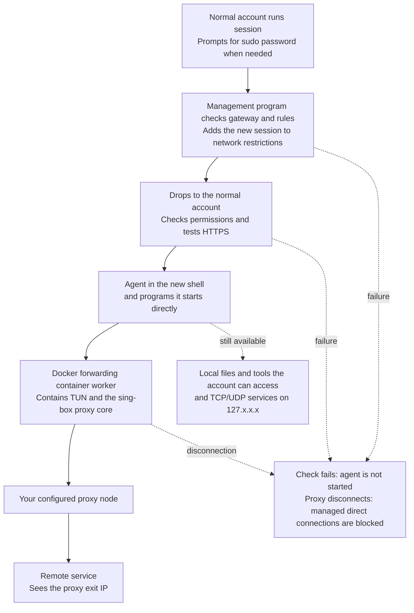

# Agent Network Sandbox (Enhanced sing-box Edition)

[繁體中文](README.md) | [简体中文](README.zh-CN.md) | [English](README.en.md)

Let your AI agent access the internet through a proxy you choose, reducing the chance of exposing your real public IP when it connects or automatically sends usage information. When connections follow the proxy path normally, remote services see the proxy's exit IP.

This is an enhanced version of the original simple SOCKS edition. It **includes the sing-box proxy core inside a Docker container**, so you no longer need to run a separate local SOCKS endpoint. It also adds stricter permission limits, checks before startup, and protection against direct connections when the proxy or network fails.

The included `network.json` uses Hysteria2 as an example. This edition reads supported configurations for the pinned sing-box 1.14.2 core and derives the required outer TCP/UDP connections, port hopping, outbound candidates and detours. It configures the host and container routes, firewall and DNS automatically. Changing a supported protocol does not require editing two sets of rules; see the [protocol and feature matrix](docs/protocol-matrix.md) for the complete boundary.

The program also selects a usable cgroup v1 or v2 mode automatically, **preferring v1**. Controlled host tests with Hysteria2 and HTTP CONNECT have passed on Ubuntu 20.04.6 hybrid/v1, Ubuntu 26.04.1 pure v2, and Debian 13.7 KVM pure v2. See the [verification records](docs/VERIFICATION.md) for each environment's tested failure scenarios and limits.

The agent still runs on your computer and can use files, development tools, and local services that its account can normally access. It can also launch GUI applications. This project focuses on reducing the obvious proxy settings and TUN interface clues available to ordinary telemetry, making the network environment less likely to be mistakenly flagged as unusual. The maintainer has used this setup with Claude Code for several months, with stable everyday operation.

## Why use this approach instead of a system-wide TUN or an HTTP/HTTPS proxy?

**The two main goals are to strictly block direct connections when the proxy is unavailable (fail-closed), and to reduce obvious proxy clues.** The system and Docker container handle forwarding, changing the exit only for the designated group of programs. You do not need to configure a proxy separately for the agent and every tool it uses.

**Fail-closed means losing connectivity when the proxy or network fails, rather than bypassing the proxy and using your real exit.** For the agent and other programs inside the sandbox, an unavailable proxy should cause failed, timed-out, or interrupted connections, rather than silently continuing through the computer's original public IP.

This is a key difference from a system-wide TUN setup that only changes routing and lacks properly configured protection against direct fallback. Some TUN tools restore the original routes when they disconnect, exit, or reconnect, allowing traffic to go out directly during that interval. Automatic reconnection alone does not guarantee that direct connections are blocked while reconnecting. TUN tools with correctly configured protection can also operate fail-closed; you still need to check their specific settings.

In this edition, the rules that block direct connections do not depend on the proxy core staying alive, and shared restrictions remain in place during exit cleanup. Within the managed scope, a stopped proxy process, a disconnected proxy tunnel, or a network failure interrupts external connections. The system does not automatically allow the real exit to restore connectivity.

The main difference between these three approaches is what the agent can readily inspect:

- **HTTP/HTTPS proxy:** The proxy address often appears in application settings, startup arguments, or environment variables, where it is easy to read. Tools that do not use those settings may also connect directly.
- **System-wide TUN:** A visible TUN interface and related routes usually appear on the computer, leaving more obvious virtual interface clues. Other programs may switch exits too.
- **This project:** No proxy environment variables are set for the agent, and the TUN interface is inside the Docker container. The management program and proxy configuration are stored in a directory accessible only to root. The agent runs under a normal account; without the relevant permissions, it cannot inspect container settings through Docker's management interface or read iptables rules directly.

Programs make connections to their intended websites as usual, while the system forwards those connections behind the scenes. Using the programs feels like a direct connection, but their actual public exit is still the proxy. The container and forwarding process also use ordinary component names, reducing the chance that common proxy names appear during routine inspection. These choices help reduce cases where ordinary telemetry flags the network environment as unusual based only on obvious clues.

**The agent can still inspect local IP addresses, interfaces, and routes, but the public exit IP reported by an external website should be the proxy's exit.** The host's interface list does not include the TUN interface inside the container. Local network information alone cannot reliably establish whether a proxy or network isolation is in use. This also does not mean a program deliberately investigating the host can never discover other clues.

| Comparison | This project | System-wide TUN | HTTP/HTTPS proxy settings |
| --- | --- | --- | --- |
| Readily visible proxy clues | No proxy variables are needed; TUN is inside the container, and only administrators can read the proxy settings. | The TUN interface and related routes are usually visible. | The proxy address may appear in application settings, startup arguments, or environment variables. |
| Which programs use the proxy | The agent started through `session` and programs it starts directly. | Usually covers the entire computer; selecting only some programs requires additional routing rules. | Depends on which programs use the proxy settings. |
| Must every tool support proxies? | Usually no; the system handles forwarding. | Usually no; the system handles forwarding. | Each tool needs checking, and child programs may not use the same settings. |
| UDP communication | Forwarded through the proxy by sing-box; the selected protocol, node, and supporting configuration must support UDP. | Depends on the tool and proxy service. | Ordinary HTTP/HTTPS proxy settings cannot handle UDP. |
| When the proxy or network fails | Remains fail-closed: managed programs lose connectivity without falling back to direct connections; restrictions remain during exit cleanup. | Without proper protection, exiting or reconnecting may restore the original routes and send traffic directly. Correctly configured tools can prevent this. | Proxy settings alone provide no system-level protection against direct fallback; whether a program retries directly depends on the program. |
| Effect on other programs | Programs already running in other terminals do not automatically switch exits. | Browsers, downloads, and other programs may switch exits too. | Can be configured for individual programs, but each must be checked for omissions. |

This project also uses TUN internally. The difference is that it places TUN inside a container and covers only the designated group of programs. If you want the whole computer to use a proxy, a system-wide TUN is more direct. If you use only one tool that explicitly supports HTTP proxies, configuring that tool directly is also simpler.

## What you need before starting

- **A compatible Linux/systemd computer.** The program first tries writable cgroup v1 `net_cls` with a working kernel match, then systemd cgroup v2 with legacy `xt_cgroup --path`. Both IPv4 and IPv6 matches must work; startup is refused if neither mode qualifies. Tested environments include Ubuntu 20.04.6/systemd 245 hybrid, Ubuntu 26.04.1/systemd 259 pure v2, and Debian 13.7/systemd 257 pure v2. Other versions still require local capability checks and the corresponding acceptance tests.
- **A standard Docker installation and Docker Compose.** Docker must be managed by the system administrator. Rootless Docker, or placing the gateway inside another ordinary container, is not a direct substitute.
- **Legacy firewall tools.** The system needs `iptables-legacy`, `ip6tables-legacy`, and their corresponding restore commands. You do not need to switch the computer's default firewall tools to legacy.
- **A proxy node usable with the pinned core.** Nodes currently need fixed IPv4 addresses, and the final proxy must guarantee TCP. Supported protocols, explicit port ranges and proxy chains are described below; domain/IPv6 nodes and dynamic discovery have not been adapted.
- **An administrator account with sudo access.** This is used for installation, network preparation, and starting sessions. The agent itself can run under a separate normal account without sudo access.

The system also needs Bash, curl, jq, iproute2, util-linux, procps, the Docker CLI, and systemd commands. Python 3 is used by the test tools; everyday agent startup does not depend on Python.

You can first run a few checks in a terminal without changing networking:

```bash
docker compose version
systemctl --version
iptables-legacy --version
ip6tables-legacy --version
findmnt -t cgroup,cgroup2
cat /proc/1/cgroup
test -c /dev/net/tun && echo "TUN available"
```

For an older Compose version, replace the first line with `docker-compose version`. These commands can reveal some missing requirements, but do not replace the complete startup checks. Do not change the whole computer's cgroup or firewall configuration merely to make these checks pass.

## Additional protection: change the timezone and language

Before use, consider adjusting the computer's timezone and the language used by the account that runs the agent. Even after switching to a proxy IP, the agent may still read and upload the original timezone and language, allowing a remote service to infer your location.

Choose settings based on the proxy exit's location and your own needs. For example:

- **Timezone:** UTC, or a timezone for a city such as New York or Los Angeles. The United States has multiple timezones, so choose a specific city.
- **Language:** English (United States or United Kingdom), or another language such as German or French. Adjust date and number formats too.

**This edition inherits the timezone and language of the terminal that starts it; it does not automatically switch to another region.** The examples below use UTC and English (United States) on Ubuntu Desktop. Replace these with your preferred timezone and language.

### 1. Choose and change the timezone

In Ubuntu, open Settings → Date & Time and turn off Automatic Time Zone so the system does not change it back based on your location. Automatic time synchronization can stay enabled; you do not need to set the clock ahead or behind.

For example, to use UTC:

```bash
sudo timedatectl set-timezone UTC
timedatectl
```

For New York, replace `UTC` with `America/New_York`; for Los Angeles, use `America/Los_Angeles`. Use `timedatectl list-timezones` to see other available timezones.

**This changes the timezone for the whole computer and remains in effect after you exit the sandbox.**

### 2. Choose and change the account language

1. Open Settings → Region & Language. Some Ubuntu versions place this under System.
2. Choose your language, such as **English (United States)** or **English (United Kingdom)**. If it is unavailable, first install the corresponding language packages through Manage Installed Languages.
3. Change Formats to the corresponding region so date and number formats are adjusted too.
4. Save, then **log out of Ubuntu and log back in**. Closing the terminal or locking the screen is not enough for every program to apply the new settings.

Language settings mainly affect the current account and remain in effect after you exit the sandbox. If the agent uses a separate dedicated account, check that account's settings too.

### 3. Confirm the settings before starting the agent

After logging back in, open a new terminal and run:

```bash
date '+%Z %z'
locale
```

Confirm that the results match your choices. For example, UTC and English (United States) should normally show `UTC +0000`, with language settings based on `en_US`.

If old settings still override your choices, check whether `~/.bashrc` or `~/.profile` for either the launching account or the agent account explicitly sets a language or timezone. Check again after entering `session`, because an interactive shell reads its own settings.

These changes only reduce direct reporting of the original timezone and language. They do not change fonts, the hostname, account information, or other local data.

## How to use it

The following examples install the project in `/opt/session`. Only root will be allowed to access the installation directory. **Do not use it as the agent's working directory**; keep your projects somewhere the normal account can read and write.

If an older sandbox is still running, use its existing launcher to close every session, then follow the [offline upgrade and rebinding procedure](docs/offline-upgrade.md). A legacy four-line binding or simple ready marker cannot be reused. Do not let both sets of rules manage the same traffic, or clear the computer's entire firewall to resolve conflicts.

### 1. Put the project in its final installation directory

Run these commands in a normal account's terminal. They download this project's public repository:

```bash
sudo install -d -o root -g root -m 0700 /opt/session
sudo git clone https://github.com/alexliyu7352/agent-network-sandbox-enhanced.git /opt/session
```

`/opt/session` must either not exist yet or be empty. The program uses this project directory directly; it does not copy it elsewhere for installation.

The installation directory and its parent directories must be owned by root and must not be writable by other accounts. The path may contain only English letters, digits, `/`, `_`, and `-`. Do not recursively change ownership or permissions across all of `/opt` or other projects merely to pass the checks.

### 2. Configure the built-in sing-box proxy

```bash
sudoedit /opt/session/network.json
```

The instructions below start with the included Hysteria2 example. In `outbounds`, find the entry whose `type` is `hysteria2` and update these fields:

| Field | Example value | What to enter |
| --- | --- | --- |
| `server` | `192.0.2.1` | The proxy server's actual IPv4 address; a domain name is not accepted. |
| `server_port` | `443` | The proxy server's actual port. |
| `password` | `CHANGE_ME` | The password provided by your proxy service. |

**The address and password in the public edition are examples and cannot be used as supplied. Do not commit a configuration containing real connection details to a public repository.**

**Static policy adaptation is implemented for:** Hysteria 1/2, TUIC, Shadowsocks, Trojan, VMess, VLESS, AnyTLS, Snell 4/6, HTTP/HTTPS CONNECT, TCP through SOCKS4/4a/5, SOCKS5 UoT, SSH, Naive, and ShadowTLS 1/2/3 as a detour wrapper. It also covers selector, urltest, compatible detours, explicit Hysteria port-hopping ranges, and the V2Ray transport, UoT and multiplex combinations listed in the matrix. Naive requires the corresponding image build tag, which is present in the inspected amd64 test image.

The [public configuration examples](examples/proxies/) and [pinned-core protocol matrix](docs/protocol-matrix.md) describe each configuration's outer transport, payload capabilities and rejection reasons. You still supply the correct protocol, authentication and certificates for your server. The program does not scan nodes or guess credentials. Official documentation changes over time; fields must match this project's pinned 1.14.2 core.

The host and container use the same [policy compiler](gateway-policy.jq). It follows every candidate and detour to determine the actual outer endpoints and allows only the required IP/protocol/port or range. For example, Hysteria2 `network:"tcp"` limits the payload while its outer connection remains UDP; a TCP CONNECT proxy uses outer TCP. Native SOCKS UDP negotiates a relay dynamically and is not adapted: explicitly choose TCP or compatible UoT. Unknown options, direct exits, additional services, remote rule sets and unmanaged DNS/routing are rejected.

The current example retains `tls.insecure: true`, which skips certificate verification for the proxy server. An encrypted connection alone does not establish that the node's identity has been verified. If the node provides a verifiable certificate, adjust the TLS settings to match the server's requirements; do not treat skipping verification as necessary.

The program leaves your source `network.json` untouched and does not automatically change TLS, authentication or logging. The source `log.level` controls logging; Compose no longer overrides it through `LOG_LEVEL`. Changing these fields also counts as a configuration change and requires offline rebinding.

Keep the examples' managed TUN, DNS and route structure. DNS always uses `proxy`, retains the IPv4 strategy and enabled cache, and selects `1.1.1.1:53` when every candidate guarantees UDP. When only TCP is guaranteed, the effective configuration uses HTTPS DNS through the proxy, querying `/dns-query` at `1.1.1.1:443` with TLS verification for `cloudflare-dns.com`. The resolver is never added to the direct outer-endpoint allowlist.

**The final proxy must guarantee TCP; UDP depends on the configuration and server.** An exit that supports only TCP can use HTTPS DNS, but ordinary UDP applications fail. A mixed candidate group guarantees UDP only if every candidate can carry it. Startup warns when UDP is not guaranteed; that warning is not evidence that UDP was tested. QUIC protocols such as Hysteria2 still require access to the node's outer UDP ports. A working webpage does not replace UDP, DNS and failure-blocking tests.

### 3. Install the `session` command

```bash
sudo /opt/session/install-dev-session.sh --check
sudo /opt/session/install-dev-session.sh
```

The first line only checks. The second tightens permissions on the project directory and creates the `/usr/local/bin/session` launcher. It does not start the container or change routes or firewall rules.

After installation, only root can enter `/opt/session` or read and write the proxy configuration. This prevents the agent from reading node details directly. Do not reopen the installation directory to normal accounts.

Installation is refused if the checks find files owned by a normal account, files writable by others, or symbolic or hard links. Use the previous step to obtain a clean, root-owned copy of the project. Do not treat arbitrary files as trusted programs merely because you have changed their owner to root.

### 4. Build and start the forwarding container

```bash
sudo docker compose -p worker -f /opt/session/docker-compose.yml build
sudo docker compose -p worker -f /opt/session/docker-compose.yml up -d
sudo docker compose -p worker -f /opt/session/docker-compose.yml logs --tail=50 worker
```

For Compose v1, replace `docker compose` with `docker-compose`.

The container is named `worker`. The proxy configuration is mounted read-only at runtime and is not copied into the Docker image. Logs without obvious errors do not prove internet access is working; the next step still performs checks.

### 5. Initialize network restrictions

```bash
session init
```

This step creates the network rules and forwarding path used by this tool. It does not replace the computer's original default gateway or disable IPv6 across the whole system.

Run `init` only after all sessions managed by this tool have ended. If the container is not ready, the command fails and retains any restrictions already created. Check the container logs, resolve the problem, and try again.

The first initialization selects a cgroup mode and writes a version 2 binding covering that mode, cgroup identity, the container/Docker network/network namespace, the normalized policy, and SHA-256 hashes of the source configuration, effective configuration and compiler. Admission rechecks these values. A password, TLS or log change counts, as does a container restart that changes its network namespace. `init` does not automatically accept a new identity: close every session and follow the [offline procedure](docs/offline-upgrade.md).

**Success from `init` or `check` only means local rule checks passed. It does not test whether the proxy can actually reach the internet.**

### 6. Open a session as a normal account, then start the agent

Return to a project directory that the normal account can read and write, then run:

```bash
session
```

**For everyday use, run `session` directly as a normal account, without adding sudo.** The launcher calls sudo itself when administrator access is needed to configure networking, prompting for your password if necessary. The management program drops back to the normal account, confirms permissions and connectivity, and only then opens a new shell.

This edition explicitly refuses to run agents as root. The management program's use of sudo does not give the agent root access. Do not start the agent directly from an outer root terminal either.

After successful startup, the new shell remains in your original project directory. **Run your usual agent startup command here.** Only the agent started here and programs it starts directly receive these network restrictions. Programs already running in other terminals are not added automatically.

You can also run a single command directly. The command and its arguments must follow `--`:

```bash
session -- /usr/bin/curl -q --noproxy '*' -4 https://example.com
```

**If startup fails, you are still in the ordinary outer terminal. Do not assume you have entered the sandbox and start the agent there.**

### 7. Confirm that connections use the proxy IP

Run this inside the newly opened session:

```bash
curl -q --noproxy '*' -4 --fail --show-error --connect-timeout 5 --max-time 15 https://www.cloudflare.com/cdn-cgi/trace
```

The value after `ip=` in the output is the public IP used by this connection. Confirm that it matches your proxy's exit. **The startup check only confirms HTTPS connectivity; it does not automatically compare this IP with your expected exit.**

The `-q` and `--noproxy '*'` options ignore curl's own configuration file and proxy settings, allowing you to check the system forwarding path.

### 8. Exit when finished

Save your work and exit the agent or application normally, then enter this in the session:

```bash
exit
```

The system stops programs inside this session. It first requests a normal shutdown, then forcibly terminates programs still running after about 10 seconds. **Background tasks started inside the session are stopped too.**

Rules that block direct connections remain in place; cleanup does not remove the restrictions first. You can inspect sessions still running from the outer terminal:

```bash
session status
```

To close a session manually, replace the example below with the 32-character session ID shown at startup:

```bash
session close 0123456789abcdef0123456789abcdef
```

When all agents are finished, you can also stop the forwarding container:

```bash
sudo docker compose -p worker -f /opt/session/docker-compose.yml stop
```

Stopping the container disconnects any sessions still using it from the internet. It does not switch them back to the real exit.

### Optional: use a dedicated account for the agent

If you do not want the agent to use your everyday account directly, an administrator can create a normal account such as `runner`:

```bash
sudo adduser --disabled-password --gecos '' runner
sudo -u runner mkdir -p /home/runner/project
session -u runner --cwd /home/runner/project
```

`runner` does not need sudo access and should not belong to administrative groups such as `sudo`, `docker`, or `lxd`. It has its own HOME, agent login information, and settings. You need to prepare its working files and development environment.

Supplementary groups are cleared when the session runs, so adding the account to a project group alone may not give it access to that project. Use the account's own working directory, or have an administrator grant access only to the required project. Do not open your entire everyday account's HOME to it.

Without `--cwd`, the default is the directory where you run `session`. If the target account cannot enter that directory, startup fails explicitly rather than silently continuing in another directory.

### GUI applications, language, and file permissions

When you run `session` from your own desktop terminal, it preserves that terminal's language, timezone, and default permissions for new files. To specify file permissions separately, use an option such as `session --umask 0022`.

When using the same account, selected desktop settings needed by X11/Wayland are also passed through to support GUI applications. When switching to another account such as `runner`, your desktop access credentials are not passed to it.

This does not mean every GUI application has been verified to work. Some programs hand work to an instance already running outside the session. Opening a new window does not automatically bring that instance under this tool's restrictions. Check which session contains the process actually doing the work.

Ordinary proxy environment variables are not inherited directly from the outer terminal. However, the agent's own settings or `~/.bashrc` may set proxy, language, or timezone values again; check them separately.

## How it works

### Connection diagram



The system tracks which programs were started from this session and sends their external IPv4 connections into the designated Docker container. Inside the container, sing-box receives connections through TUN and sends them through the configured proxy exit; the included example uses Hysteria2. In normal use, the agent does not need to know the proxy address.

cgroup v1 uses a `net_cls` classid. v2 keeps a systemd `devsession.slice` parent active, creates session services beneath it, and matches descendants using the parent's path in legacy netfilter. The selected mode does not change automatically while the policy is bound. A changed mount, parent identity or boot identity retains restrictions and refuses new sessions. The v2 parent remains after the last session exits so existing sockets and rules retain the identity they rely on.

The additional protections have several roles:

- **Keep management privileges away from the agent.** Root access needed to configure networking stays with the management program. Before the agent starts, it drops to a normal account, clears supplementary groups and available administrative capabilities, and blocks ordinary ways of regaining administrator privileges.
- **Start the agent only after checks pass.** The gateway, firewall, and routes are checked first. The program then uses the actual agent account to enter the working directory, check permissions, and test HTTPS. If any step fails, your command is not executed.
- **Stop connections when the proxy fails.** The system retains an unusable fallback route and checks the final outgoing interface. The container itself also allows only traffic through TUN or outer traffic to the designated node, preventing fallback to an ordinary exit if the proxy fails.
- **Use a consistent path for ordinary hostname lookups.** DNS translates website names into IP addresses. IPv4 TCP/UDP queries to port 53 from the session are sent to the container, then through the same proxy to `1.1.1.1`, with caching enabled.
- **Manage each session separately.** Each session opens a separate systemd service responsible for stopping all its programs. Shared network rules do not keep growing with the number of sessions.
- **Keep restrictions during cleanup.** Exiting stops only the corresponding session and removes its temporary data. It does not remove the shared rules that block direct connections or clean up other sessions' networking.

## What it cannot do

### It restricts networking, not all local operations

The agent still uses the computer's existing filesystem and tools. It can inspect local IP addresses, interfaces, routes, processes, and other local information it has permission to read. This tool does not separately restrict which files it can read, how much memory it can use, or which ordinary programs it can launch.

Distinguish two kinds of addresses: local IP addresses on interfaces, such as `192.168.x.x` and `10.x.x.x`, describe the computer and its local network. The public exit IP obtained through an external website should be the proxy's exit IP. Being able to inspect local interfaces and routes does not mean a managed connection reports the computer's original public exit.

This tool does not rewrite interface information or remove addresses already stored in files. If a public IP is configured directly on a host interface, that address remains readable as local host information too.

Communication with local services and between processes remains available. If the agent hands work to a service already running outside the session, or asks a local service to connect on its behalf, that service is not automatically covered by these network restrictions. This is therefore not a complete sandbox for running untrusted malicious programs.

### Manage what the agent uploads separately

This tool changes the connection's exit; it does not remove the contents the agent uploads. If it uploads an account identifier, device ID, hostname, timezone, file contents, or local IP, a remote service may still recognize the device or environment. These contents are separate from the connection's public source IP: a connection sent through the proxy still comes from the proxy exit. Check the agent's own privacy and telemetry settings separately.

The proxy provider may also observe or record connections. This tool does not guarantee anonymity from the proxy provider, or that every agent will believe it has a direct connection.

### Connectivity has limits

| Connection type | Behavior in this edition |
| --- | --- |
| TCP/UDP to public IPv4 addresses | Forwarded through the Docker gateway and proxy graph. Ordinary UDP requires a compatible exit and server; an exit supporting only TCP does not fall back to direct UDP. |
| TCP/UDP to the local computer at `127.0.0.0/8` | Any port is allowed, except that destination port 53 is intercepted separately. |
| TCP/UDP port 53 at any IPv4 address | Sent to the container, then through the proxy to `1.1.1.1`. |
| Private, LAN, link-local, multicast, and similar addresses | Rejected; direct connections to routers or other LAN devices are not allowed. |
| IPv6, including local `::1` | Rejected; IPv6-only services cannot be used directly. |
| ICMP, such as ordinary ping | Not supported as proxy traffic; ping success or failure cannot establish whether the proxy works. |

The fixed DNS server may prevent access to internal company domains or services that require private DNS. Tools that look up names over HTTPS/TLS are handled as ordinary connections, without conversion to port 53 queries. Asking another local service to resolve names falls under the local-service behavior described above.

### Successful startup does not guarantee continued connectivity

The HTTPS check runs once at startup. It is not continuous health monitoring and does not automatically verify the exit IP. The proxy can still disconnect after you enter the session; connections should then fail rather than automatically switch to another path.

You can open multiple sessions at once, but they share one exit configuration. Each session does not receive a different public IP.

## Current limitations to keep in mind

| Situation | Recommended action |
| --- | --- |
| The system has only cgroup v2 | The program tries systemd v2 and both IPv4/IPv6 legacy path matches, refusing startup if requirements are missing. Ubuntu 26.04.1 and Debian 13.7 KVM passed the pure-v2 scope listed below; this does not remove local capability checks or justify blindly changing boot settings. |
| Changing protocol, transport, port hopping or detours | Configure a supported combination from the [protocol matrix](docs/protocol-matrix.md); rules are derived automatically. Discovery beyond fixed IPv4 and unlisted capabilities are rejected. |
| Changing any source configuration or the compiler after initialization | Source, effective and compiler hashes must match. Close every session and [rebind offline](docs/offline-upgrade.md). Password, TLS, logging and JSON-format-only changes also count. |
| Container restart/recreation/rebuild or Docker network recreation | A changed container ID, network ID or network namespace requires offline rebinding, even if the container name stays the same. |
| Docker daemon restart | If identities match and only rule order changed, close every session before repairing with `session init`. A changed namespace or other binding identity requires the offline procedure. Recovery is not seamless. |
| The launcher is forcibly killed, for example with `SIGKILL` | The session may keep running, but restrictions remain in place. Use `session status` and `session close ID` to manage it. |
| A remote tool passes sockets directly as standard input/output | Startup is refused. Use a regular terminal, PTY, or pipe. |
| Starting directly from a root terminal | If the original caller's normal account cannot be determined, use `-u ACCOUNT` to select a normal account explicitly. Root workloads are not allowed. |
| Uninstalling the tool | Exit all agents and sessions first, then stop the gateway. Have an administrator identify and remove only this tool's shared rules and state, then remove the installation directory and `session` launcher. There is currently no automatic uninstall command. Do not simply delete the directory or clear the whole computer's rules. |

Do not delete the state in `/run/dev-session-v8` to force acceptance of a new gateway, or clear the computer's entire firewall to resolve errors. Retaining shared restrictions after exit is intentional in this edition. The presence of remaining rules alone is not a cleanup failure.

## Testing

### Check with a browser (GUI applications)

This project can also let GUI applications use the sandbox network; it is not limited to command-line programs. A browser provides a convenient visual check:

1. Enter the sandbox from a terminal in your normal desktop account, then **launch the browser from inside the sandbox shell**.
2. Fully close existing browser processes first, or use a separate profile and a new independent instance supported by that browser. Opening a browser from the desktop, or having a launch command hand the page to an existing process outside the sandbox, does not ensure that browser is covered.
3. Open [BrowserLeaks](https://browserleaks.com/) or [BrowserScan](https://www.browserscan.net/) and check public IP, WebRTC, DNS, timezone, and language results.
4. **The public IP should be the proxy's exit. Any public address shown by WebRTC should also be the proxy's exit, or no public result should be available.** A local private IP alone does not indicate exposure of the real public exit. If the original public exit appears, stop using the setup and investigate.

DNS tests may show resolver addresses, which normally differ from the proxy's exit IP. A difference alone does not prove a leak. The browser's own encrypted DNS settings can also affect the results. Switching exits does not automatically change timezone, language, fonts, or other browser information. A proxy/VPN label on a website does not establish exposure of the real exit either; check the actual addresses reported by each test.

Only test disconnection where interrupted networking is acceptable: keep the sandbox and browser running, pause the proxy from outside, and make a new network request. The request should fail rather than use the original public exit. Cached or previously loaded pages cannot establish whether connectivity still works. Browsing detection websites reflects only those test requests and does not replace failure testing or packet inspection.

With a dedicated account, the browser needs a desktop environment accessible to that account. `session -u runner` does not automatically receive your everyday account's desktop authorization.

### Check file syntax only

These commands only check shell syntax. They do not execute script contents, start containers, or change networking. Run them in the project directory:

```bash
bash -n dev-session
bash -n session-launcher
bash -n install-dev-session.sh
bash -n lib/main.sh
bash -n lib/host.sh
bash -n lib/network.sh
bash -n lib/cgroup.sh
bash -n lib/session.sh
bash -n lib/cli.sh
bash -n lib/context.sh
sh -n entrypoint-gateway.sh
```

To check the release files' SHA-256 hashes, run the following **before entering real proxy details or changing other files**:

```bash
sha256sum -c MANIFEST.sha256
```

Matching hashes only establish that files agree with this manifest. They do not establish that network isolation has passed real-host verification.

### Offline regression and real-host tests

`tests/test_*.py` contains regression tests that execute scripts and create temporary test environments. Some tests need root, a normal account, or a specified sing-box executable and may be skipped if requirements are not met. Read the tests before running them in a suitable test environment.

**`tests/host_*.py` really starts sessions and changes test networking. Some tests also stop the gateway or restart Docker. Use them only on a recoverable test machine where network interruption is acceptable.** Do not run the full failure-testing suite directly on your everyday work computer.

For repeat verification, use the [real-host acceptance checklist](docs/host-validation.md). A working webpage, a test without FAIL results, or a skipped item due to insufficient permissions does not replace verification of UDP, DNS, blocking on failure, and exit cleanup.

### Existing verification records

As of **2026-10-19**, results are recorded by the layer actually exercised:

| Layer and environment | Verified scope |
| --- | --- |
| Configuration checks | All 24 public proxy examples passed the shared compiler and actual sing-box 1.14.2 core checks. Their fake endpoints are not usable nodes. |
| Real protocol loopback | All 47 client/server cases passed TCP, UDP delivery or refusal according to capability, DNS caching/TTL, and blocking after server shutdown; these include Hysteria1/2 port hopping, Snell4, SSH, and ShadowTLS 1/2/3. This layer does not run host cgroup, TUN, or firewall acceptance. |
| Ubuntu 20.04.6 hybrid/v1 | Hysteria2 and HTTP CONNECT each passed 17/17 core/failure checks and exit-IP comparison. Additional v1 results include lifecycle 10/10 with 100 short sessions, capabilities 13/13, and CLI 9/9. |
| Ubuntu 26.04.1 native pure v2 | Hysteria2 and HTTP each ran healthy, gateway-stop, gateway-kill, gateway-recreate, and docker-restart: all 10 CI jobs passed, including real sessions, packet inspection, exit-IP comparison, and lifecycle checks. |
| Debian 13.7 KVM pure v2 | Both Hysteria2 and HTTP healthy jobs passed: each includes core 16/16, lifecycle 10/10, 100 short sessions, and exit-IP comparison. Container/Docker namespace failure scenarios on Debian are outside these two jobs' scope. |

The pure-v2 results come from [CI 39182626891](https://github.com/alexliyu7352/agent-network-sandbox-enhanced/actions/runs/39182626891) at `58dcfad596856fc3696d138f84d1c0f37e6e0ebd`: **12/12 jobs passed**. The v2 evidence also matches actual socket inodes created by sessions to their service cgroups. Container recreation changed both the container ID and namespace. The old binding and shared rules remained, while `check`, `init`, and new workload admission refused the changed identity. Offline rebinding is required; the program does not automatically adopt a new namespace.

Controlled DNS tests cover shared caching across TCP/UDP queries, TTL expiry/refetch, and expected failures when disabling the cache or removing the HTTPS DNS detour. SSH uses the pinned core client and a separate Paramiko 3.5.1 server. ShadowTLS uses an inner Shadowsocks/UoT proxy and a private TLS cover that sends no session tickets; certificate verification remains enabled. These results apply to the concrete configurations in the [protocol matrix](docs/protocol-matrix.md). The complete host egress matrix for individual protocols and actual X11/Wayland window acceptance still await their respective results. Unlisted protocol options and host environments do not inherit the results above.

Host fixtures use isolated proxies with fake authentication on the same machine. Exit-IP equality proves that managed requests match an independent observation from the designated fixture; it does not establish remote anonymity or the quality of your actual node. See the [verification records](docs/VERIFICATION.md) for versions, commands, CI artifacts, skip reasons, and historical results. Public summaries omit private nodes, credentials, actual exit IPs, and raw packet captures. These changes remain on a work branch and have not been merged into `main`; merging requires separate review and explicit approval.

## FAQ

**The container is running. Why does `session` still fail?**

First confirm that the protocol, address, authentication and TLS match your server, that its required outer TCP/UDP ports are reachable, and that you have run `session init`. If you changed configuration or restarted/recreated the container, check whether offline rebinding is required. Read the gateway logs:

```bash
sudo docker compose -p worker -f /opt/session/docker-compose.yml logs --tail=50 worker
```

`session check` can recheck local network restrictions, but does not test proxy connectivity. If startup fails, do not start the agent directly in the outer terminal.

**Why can't a normal account read the installation directory?**

This restriction is intentional: it prevents the agent from reading proxy settings directly. Use administrator access when changes are needed, and keep the agent's working files in another directory accessible to the normal account.

**Why can't `runner` enter the current directory?**

`runner` does not have access to that directory. Prepare a separate working copy for it, or grant access only to the required project. You can also use `--cwd` to specify a directory it can access.

**How do local IP addresses differ from the public exit IP?**

The agent can read local IP addresses, interfaces, and routes. Those details are separate from the public exit used for outgoing connections. **With restrictions working and connections following the proxy path, both the exit IP reported to the agent by an external website and the source IP actually seen by the remote service should be the proxy's exit IP.**

For example, an interface showing `192.168.1.10` while a public-IP lookup reports the proxy's exit is normal. It does not mean the real public exit has leaked. Local host data is not rewritten by this tool, so files and telemetry contents still need separate management.

**The agent's tools or virtual environment are missing.**

The session does not copy every environment variable from the outer terminal. Activate the required virtual environment after entering, or prepare the tools in that account's settings. The default command search order uses system directories first, followed by the account's `~/.local/bin`.

**Why does ping fail while HTTPS works?**

ping uses a different form of communication. This edition does not forward ICMP like an ordinary VPN. Check the TCP/UDP functions you actually need rather than relying on ping alone.

## Project files and other settings

| File | Purpose |
| --- | --- |
| [README.md](README.md) | Installation, usage, and limitations. |
| [network.json](network.json) | sing-box proxy and DNS settings; the public edition provides example values using Hysteria2. |
| [gateway-policy.jq](gateway-policy.jq) | Shared host/container compiler for policy and effective configuration. |
| [examples/proxies/](examples/proxies/) and [protocol matrix](docs/protocol-matrix.md) | Pinned-core examples, transport capabilities and rejection reasons. |
| [Offline upgrade procedure](docs/offline-upgrade.md) | Update versions, change configuration or rebind a gateway after closing sessions. |
| [policy.json](policy.json) | Startup check URL and policy version. |
| [docker-compose.yml](docker-compose.yml) | Docker forwarding container configuration. |
| [Dockerfile.gateway](Dockerfile.gateway) | Builds an image containing sing-box and gateway tools. |
| [entrypoint-gateway.sh](entrypoint-gateway.sh) | Creates restrictions and the forwarding path when the container starts. |
| [install-dev-session.sh](install-dev-session.sh) | Checks the installation path, tightens permissions, and installs the `session` command. |
| [session-launcher](session-launcher) | Public launcher template that preserves selected terminal settings before sudo. |
| [dev-session](dev-session) and [lib/](lib/) | Manage sessions, permissions, network checks, and exit cleanup. |
| [tests/](tests/) | Regression and real-host acceptance tools. |
| [docs/](docs/) | Verification summaries, acceptance checklist, and historical technical notes. |
| [MANIFEST.sha256](MANIFEST.sha256) | Hash manifest for this edition's release files. |

The `probe_url` in `policy.json` can specify the HTTPS URL tested at startup. The program uses normal certificate verification, does not follow redirects, and allows about 20 seconds for the whole check. The target must be suitable for responding directly to HTTPS requests.

For everyday use, commands include `session --help`, `session status`, `session close ID`, and `session check`. The older `sudo /opt/session/dev-session --user runner run --cwd /home/runner/project` entry point remains compatible, but only receives terminal settings after sudo has processed them. For ordinary use, run `session` directly.
