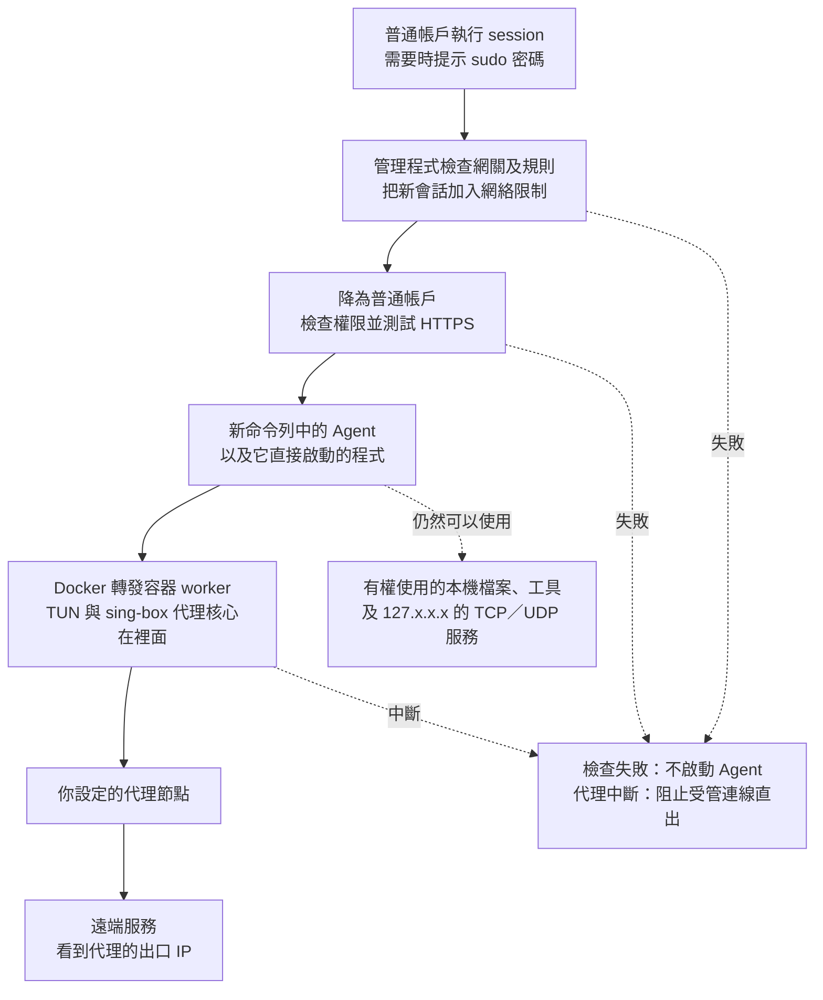

# Agent 網絡沙盒（sing-box 加強版）

[繁體中文](README.md) | [简体中文](README.zh-CN.md) | [English](README.en.md)

讓 Agent 智能體透過你指定的代理上網，減少它在連線或自動回傳使用資訊時，暴露你真實公網 IP 的機會。正常經由代理連線時，遠端服務看到的是代理的出口 IP。

這是原 SOCKS 簡易版的加強版本，**在 Docker 容器內置 sing-box 代理核心**，不再需要你另外開一個本地 SOCKS 入口；同時加入更嚴格的權限限制、啟動前檢查，以及代理或網絡故障時阻止直連的措施。

隨附的 `network.json` 使用 Hysteria2 作為配置範例。本版會依固定 sing-box 1.14.2 核心的受支援配置，自動推導代理的外層 TCP／UDP、跳埠、候選出口及 detour，配套主機和容器的路由、防火牆與 DNS。更換受支援協議不需要手改兩套規則；完整邊界見 [協議與功能矩陣](docs/protocol-matrix.md)。

本版也會自動選擇可用的 cgroup v1／v2，**優先 v1**。Ubuntu 20.04.6 hybrid／v1、Ubuntu 26.04.1 純 v2，以及 Debian 13.7 KVM 純 v2 已有 Hysteria2 與 HTTP CONNECT 的受控實機結果；各系統實際涵蓋的故障與限制見 [驗證紀錄](docs/VERIFICATION.md)。

Agent 仍然在你的電腦上運行，可以使用原本有權存取的檔案、開發工具和本機服務，也可以啟動 GUI 應用。這個專案的重點，是減少一般遙測容易看到的代理設定與 TUN 網卡線索，降低網絡環境被誤判為異常的機會。維護者已使用本方案運行 Claude Code 數月，日常運行穩定。

## 為什麼用這種方式，而不是全局 TUN 或 HTTP／HTTPS 代理

**兩個重點是：代理不可用時嚴格阻止直連（fail-closed），以及減少明顯的代理線索。** 實際轉發由系統和 Docker 容器處理，只替指定的這組程式更換出口，不需要逐一替 Agent 或它使用的工具設定代理。

**代理或網絡故障時，寧可斷網，也不繞過代理改用真實出口，這就是 fail-closed。** 對沙盒裡的 Agent 或其他程式來說，代理不可用時應該是連線失敗、逾時或中斷，而不是悄悄用電腦原本的公網 IP 繼續上網。

這是與只接管路由、沒有正確設定斷線保護的全局 TUN 方案相比，一個關鍵差別。有些 TUN 工具在斷線、退出或重新連線時會恢復原路由，這段期間的流量可能直接送出；「會自動重連」本身並不能保證重連期間不直連。具備正確斷線保護的 TUN 工具也能做到 fail-closed，仍需核對具體設定。

本版的防直連規則不依賴代理核心一直存活，退出收尾也會保留共同限制。在受管範圍內，代理程序停止、代理通道斷線或網絡故障的結果是外網連線中斷，不會為了恢復連線而自動放行真實出口。

三種方式的差別，主要在於 Agent 平常能直接看到什麼：

- **HTTP／HTTPS 代理**：代理地址常出現在程式設定、啟動參數或環境變數中，容易被直接讀到；沒有採用這些設定的工具，也可能直接連線。
- **全局 TUN**：通常會在電腦上出現可查看的 TUN 網卡和相關路由，留下比較明顯的虛擬網卡線索；其他程式也可能一起改變出口。
- **本專案**：不替 Agent 設定代理環境變數，TUN 網卡放在 Docker 容器內。管理程式和代理設定放在只有 root 可以存取的目錄，Agent 以普通帳戶運行，沒有相應權限就無法透過 Docker 管理介面查看容器設定，也不能直接讀取 iptables 規則。

對正常發起連線的程式而言，仍然是指定目標網站，由系統在背後代為轉發。程式的使用方式像直連，實際對外公網出口仍然是代理。容器和轉發程式也使用一般的元件名稱，減少常見代理名稱直接出現在日常檢查中的機會。這些安排有助於減少一般遙測僅憑明顯線索，就把網絡環境判定為異常的情況。

**Agent 仍然可以查看本地 IP、網卡和路由，但經外部網站查詢的公網出口 IP 應是代理出口。** 本機列表中沒有容器內的那張 TUN 網卡；僅查看本地網絡資料，不能準確判定是否經過代理或處於網絡隔離環境。這也不代表刻意調查本機的程式永遠無法發現其他線索。

| 比較項目 | 本專案 | 全局 TUN | HTTP／HTTPS 代理設定 |
| --- | --- | --- | --- |
| 容易看到的代理線索 | 不必填代理變數，TUN 在容器內，代理設定只供管理員讀取。 | 通常能看到 TUN 網卡和相關路由。 | 代理地址可能出現在程式設定、啟動參數或環境變數中。 |
| 哪些程式會走代理 | 從 `session` 啟動的 Agent 與它直接啟動的程式。 | 通常接管整台電腦；只處理部分程式需另外分流。 | 取決於哪些程式採用了代理設定。 |
| 每個工具都要支援代理嗎 | 一般不需要，由系統轉發。 | 一般不需要，由系統轉發。 | 需要逐一確認，子程式也未必採用同一設定。 |
| UDP 通信 | 由 sing-box 經代理轉發；所選協議、節點及配套設定須支援 UDP。 | 取決於使用的工具與代理服務。 | 一般 HTTP／HTTPS 代理設定無法處理 UDP。 |
| 代理或網絡故障時 | 維持 fail-closed，受管程式斷網，不回退直連；退出收尾仍保留限制。 | 未設好斷線保護時，可能在退出或重連期間回到原路由並直接送出；有正確保護的工具可避免。 | 單靠代理設定不提供系統層的斷線保護，是否重試直連取決於程式。 |
| 對其他程式的影響 | 其他終端原本運行的程式，不會自動一起換出口。 | 瀏覽器、下載及其他程式可能一起改變出口。 | 可只設定個別程式，但要逐一確認有沒有漏掉。 |

本專案內部也使用 TUN，差別在於把它放進容器，再只接管指定的這組程式。若你希望整台電腦都走代理，全局 TUN 會更直接；若只使用一個明確支援 HTTP 代理的工具，直接設定該工具也更省事。

## 使用前需要準備什麼

- **符合條件的 Linux／systemd 電腦。** 自動優先選擇可寫入且通過核心匹配探測的 cgroup v1 `net_cls`；否則嘗試 systemd cgroup v2 與 legacy `xt_cgroup --path`。IPv4、IPv6 兩套匹配都要可用，兩種模式皆不符合就拒絕啟動。已測環境包括 Ubuntu 20.04.6／systemd 245 的 hybrid 主機，以及 Ubuntu 26.04.1／systemd 259、Debian 13.7／systemd 257 的純 v2 主機；其他版本仍須通過本機能力探測與相應驗收。
- **一般的 Docker 安裝與 Docker Compose。** 需要由系統管理員管理的 Docker，不能直接換成 rootless Docker 或把網關放進另一層普通容器。
- **legacy 版防火牆工具。** 系統需有 `iptables-legacy`、`ip6tables-legacy` 及對應的 restore 命令；不要求你把整台電腦的預設工具切換成 legacy。
- **可供固定核心使用的代理節點。** 節點目前必須是固定 IPv4，最終代理至少保證 TCP。可用協議、明確跳埠區間及代理鏈見下方說明；網域／IPv6 節點與動態發現尚未適配。
- **可以使用 sudo 的管理帳戶。** 用來安裝、準備網絡和啟動會話；實際執行 Agent 的帳戶可以是另一個沒有 sudo 權限的普通帳戶。

系統還需要 Bash、curl、jq、iproute2、util-linux、procps，以及 Docker CLI 和 systemd 的命令。Python 3 供測試工具使用，日常啟動 Agent 不依賴 Python。

可以先在終端做幾項不會修改網絡的檢查：

```bash
docker compose version
systemctl --version
iptables-legacy --version
ip6tables-legacy --version
findmnt -t cgroup,cgroup2
cat /proc/1/cgroup
test -c /dev/net/tun && echo "TUN 可用"
```

若使用舊版 Compose，第一行改為 `docker-compose version`。這些命令只能幫你發現部分缺少的條件，不能代替完整的啟動檢查。請勿為了讓檢查通過，就直接切換整台電腦的 cgroup 或防火牆設定。

## 安全加強：修改時區和語言

使用前，建議自行調整電腦的時區，以及執行 Agent 的帳戶所使用的語言。即使已經換了代理 IP，Agent 仍可能讀取原本的時區和語言並上傳，讓遠端拿來推測你的所在地。

你可以按照代理出口所在地與自己的使用需求選擇，例如：

- **時區**：UTC，或美國紐約、洛杉磯等地的時區。美國有多個時區，需要選擇具體城市。
- **語言**：英文（美國或英國），也可以選擇德文、法文等其他語言，並一起調整日期和數字格式。

**本版會沿用啟動它的終端所使用的時區與語言，不會自動替你換成其他地區。** 下面以 Ubuntu 桌面版的 UTC 和英文（美國）示範，你可以換成自己選擇的時區與語言。

### 1. 選擇並修改時區

先到 Ubuntu 的「設定 → 日期與時間」，關閉「自動時區」，避免系統根據位置把時區改回去。自動校正時間可以保留，不需要把電腦的時間調快或調慢。

例如，使用 UTC：

```bash
sudo timedatectl set-timezone UTC
timedatectl
```

使用美國紐約時，將 `UTC` 換成 `America/New_York`；洛杉磯則使用 `America/Los_Angeles`。也可以用 `timedatectl list-timezones` 查看其他可選時區。

**這會改變整台電腦的時區，退出沙盒後仍然保留。**

### 2. 選擇並修改帳戶語言

1. 開啟「設定 → 地區與語言」。部分 Ubuntu 版本需要先進入「系統」分類。
2. 選擇所需語言，例如 **English (United States)** 或 **English (United Kingdom)**。若沒有該語言，先到「管理已安裝的語言」安裝對應的語言套件。
3. 將「格式」改為對應地區，讓日期和數字格式一起調整。
4. 儲存後，**登出 Ubuntu 再重新登入**。只關閉終端或鎖定畫面，不足以讓所有程式套用新設定。

語言設定主要影響目前帳戶，退出沙盒後仍然保留。若 Agent 使用另一個專用帳戶，也要確認那個帳戶自己的設定。

### 3. 確認設定，再啟動 Agent

重新登入後，開啟新終端，執行：

```bash
date '+%Z %z'
locale
```

確認結果與你的選擇一致。例如，UTC 和英文（美國）通常應顯示 `UTC +0000`，語言設定以 `en_US` 為主。

若結果仍被舊設定覆蓋，檢查啟動帳戶及 Agent 帳戶的 `~/.bashrc`、`~/.profile` 是否另外指定了語言或時區。進入 `session` 後也應再確認一次，因為互動 shell 會讀取自己的設定。

這些調整只能減少原本時區與語言被直接上報，不會改變字型、主機名稱、帳號資料或其他本機資訊。

## 怎麼使用

以下以安裝在 `/opt/session` 為例。安裝目錄會只允許 root 存取，**不要把它當成 Agent 的工作目錄**；你的專案應放在普通帳戶有權讀寫的位置。

如果舊版沙盒仍在運行，先用舊版入口結束全部會話，再按 [離線升級與重新綁定程序](docs/offline-upgrade.md) 處理。舊版四行 binding 或簡單 ready marker 不能直接沿用；不要讓兩套規則同時接管，也不要清空整台電腦的防火牆來處理衝突。

### 1. 將專案放到最終安裝目錄

在普通帳戶的終端中執行以下命令。以下命令會下載本專案的公開倉庫：

```bash
sudo install -d -o root -g root -m 0700 /opt/session
sudo git clone https://github.com/alexliyu7352/agent-network-sandbox-enhanced.git /opt/session
```

`/opt/session` 必須尚未存在或為空目錄。程式之後直接使用這份專案，不會再另外複製一份安裝。

安裝目錄及其父目錄必須由 root 擁有，不能讓其他帳戶寫入。路徑只能包含英文字母、數字、`/`、`_`、`-`。不要為了通過檢查，就遞迴修改整個 `/opt` 或其他專案的擁有者與權限。

### 2. 設定內置的 sing-box 代理

```bash
sudoedit /opt/session/network.json
```

下面先按隨附的 Hysteria2 範例說明。在 `outbounds` 中找到 `type` 為 `hysteria2` 的那一項，修改以下欄位：

| 欄位 | 範例值 | 你應該填什麼 |
| --- | --- | --- |
| `server` | `192.0.2.1` | 代理伺服器的實際 IPv4 地址，不能填域名。 |
| `server_port` | `443` | 代理伺服器的實際埠號。 |
| `password` | `CHANGE_ME` | 代理服務提供的密碼。 |

**公開版中的地址和密碼都是範例，不能直接使用。請勿把填好真實資料的設定檔提交到公開倉庫。**

**本版已實作以下配置的靜態政策適配：** Hysteria 1／2、TUIC、Shadowsocks、Trojan、VMess、VLESS、Snell 4／6、HTTP／HTTPS CONNECT、SOCKS4／4a／5 的 TCP、SOCKS5 UoT、SSH、Naive，以及作 detour 包裝的 ShadowTLS 1／2／3。另支援 selector、urltest、相容的 detour、明確的 Hysteria 跳埠區間，以及矩陣列出的 V2Ray transport、UoT 和 multiplex 組合。Naive 需要映像包含對應建置標籤；已核對的 amd64 測試映像具備此標籤。

**HTTPUpgrade 與 AnyTLS 本版明確拒絕。** 固定核心配對的 HTTPUpgrade 重複驗收在 Trojan／VMess／VLESS 上出現間歇失敗；可依服務端改用原生 TCP、HTTP、WebSocket、gRPC 或 QUIC。AnyTLS 雖通過一次有限的重用連線恢復對照，仍未通過後續節點故障解除後的 HTTPS 恢復，請改用另一個已驗收的代理協議。這些是固定核心下的具體驗收邊界；完整成功與失敗證據見[追加驗證紀錄](docs/validation-20261019-followup.md)。

未加密的 SOCKS5 UoT 或 VLESS 可能讓代理流內的 DNS／UDP 內容在鏈路上可見。端點限制與 DNS 攔截控制流量路徑，內容保密仍取決於原始代理及 TLS 設定。程式不會自動修改這些設定。

[公開配置範例](examples/proxies/) 和 [固定核心協議矩陣](docs/protocol-matrix.md) 說明每種配置的外層連線、內層能力及拒絕原因。服務端的協議、認證和憑證仍由你正確填寫；程式不探測節點、不猜密碼。官方文件會更新，欄位必須符合本專案固定的 1.14.2 核心。

[共用解析器](gateway-policy.jq) 供主機與容器一起使用。它沿全部候選和 detour 推導真正的外層端點，只放行必要的 IP／協議／埠或區間。例如 Hysteria2 的 `network:"tcp"` 只限制內層，外層仍是 UDP；TCP CONNECT 代理則使用外層 TCP。SOCKS 原生 UDP 的 relay 是動態協商，尚未適配，必須明確使用 TCP 或相容的 UoT。未知選項、direct 出口、額外服務、remote rule set、未管理的 DNS／路由等會明確拒絕。

目前範例沿用 `tls.insecure: true`，這表示略過代理伺服器的憑證驗證；連線有加密，也不能因此保證節點身分已經核實。若節點提供可驗證的憑證，請按服務端要求調整 TLS 設定，不要把略過驗證當作必要條件。

程式不修改你的原始 `network.json`，也不自動改動 TLS、認證或 log。日誌等級以原始配置中的 `log.level` 為準，Compose 不再透過 `LOG_LEVEL` 覆寫；修改這些內容也屬於配置變更，需要離線重新綁定。

請保留範例的受管 TUN、DNS 與 route 形狀。DNS 始終經 `proxy`，保持 IPv4 策略及開啟快取：所有候選都保證 UDP 時使用 `1.1.1.1:53`；只保證 TCP 時，自動生成經代理的 HTTPS DNS，向 `1.1.1.1:443` 的 `/dns-query` 查詢並驗證 `cloudflare-dns.com` 的 TLS 名稱。DNS 地址不會加入外層直連放行清單。

**最終代理必須保證 TCP，UDP 則依配置與服務端能力而定。** 只有 TCP 的出口可以正常使用 HTTPS DNS，但普通 UDP 應用會失敗；混合候選群組只在所有候選都能承載 UDP 時才把它列為保證能力。啟動時會提示 UDP 不受保證，不能把提示視為 UDP 已驗收。Hysteria2 等 QUIC 協議的外層仍需網絡允許節點 UDP；網頁能開啟不能代替 UDP、DNS 和故障阻斷的確認。

### 3. 安裝 `session` 命令

```bash
sudo /opt/session/install-dev-session.sh --check
sudo /opt/session/install-dev-session.sh
```

第一行只檢查。第二行會收緊專案目錄的權限，並建立 `/usr/local/bin/session` 啟動器；它不會啟動容器，也不會修改路由或防火牆。

安裝後，整個 `/opt/session` 只有 root 能進入，代理設定檔只有 root 能讀寫。這是為了避免 Agent 直接讀到節點資料，請勿再把安裝目錄開放給普通帳戶。

若檢查發現檔案屬於普通帳戶、可被其他人寫入，或包含符號連結／硬連結，會拒絕安裝。建議直接用上一步的方式取得一份 root 擁有的乾淨專案，不要把任意來源的檔案直接改成 root 擁有後就當成可信程式。

### 4. 建立並啟動轉發容器

```bash
sudo docker compose -p worker -f /opt/session/docker-compose.yml build
sudo docker compose -p worker -f /opt/session/docker-compose.yml up -d
sudo docker compose -p worker -f /opt/session/docker-compose.yml logs --tail=50 worker
```

使用 Compose v1 時，把 `docker compose` 換成 `docker-compose`。

容器名稱是 `worker`。代理設定只在運行時以唯讀方式掛入，不會複製進 Docker 映像。日誌中沒有明顯錯誤，也不代表已經可以上網，下一步仍會檢查。

### 5. 初始化網絡限制

```bash
session init
```

這一步才會建立本工具使用的網絡規則和轉發路徑。它不更換電腦原本的預設網關，也不全機關閉 IPv6。

`init` 只能在所有本工具的會話都已結束時執行。若容器還沒準備好，命令會失敗並保留已建立的限制；請查看容器日誌，待問題處理好後再試。

首次初始化會選定 cgroup 模式並保存版本 2 的 binding，綁定該模式、cgroup 身分、容器／Docker 網絡／網絡 namespace、正規化政策，以及原始設定、有效設定和解析器三份 SHA-256。後續入場會重新核對；即使只改密碼、TLS 或 log，或只是重啟容器但 namespace 已變，也不會沿用舊綁定。`init` 不會自動接受這類變更，請先關閉全部會話並按 [離線程序](docs/offline-upgrade.md) 重新綁定。

**`init` 或 `check` 顯示成功，只代表本機規則檢查通過，沒有替你測試代理是否真的能連上外網。**

### 6. 用普通帳戶開啟會話，再啟動 Agent

回到普通帳戶可讀寫的專案目錄，直接執行：

```bash
session
```

**日常請直接用普通帳戶執行 `session`，不用在前面加 sudo。** 需要管理員權限設定網絡時，啟動器會自行呼叫 sudo，必要時提示你輸入密碼。管理程式會先降回普通帳戶，確認權限和連線正常，才開啟新的命令列環境。

本版明確拒絕以 root 身分運行 Agent。管理程式使用 sudo，不代表 Agent 也會取得 root 權限；你也不應在外面的 root 終端直接啟動 Agent。

成功後，新命令列仍在你原本的專案目錄。**就在這裡執行平時使用的 Agent 啟動命令。** 從這裡啟動的 Agent，以及它直接啟動的程式，才會受到這組網絡限制；已在其他終端運行的程式不會自動加入。

也可以直接執行單一命令，命令及參數必須放在 `--` 後面：

```bash
session -- /usr/bin/curl -q --noproxy '*' -4 https://example.com
```

**如果啟動失敗，你仍然停留在外面的普通終端，請不要以為已進入沙盒，直接在那裡啟動 Agent。**

### 7. 確認連出去的是代理 IP

在新開啟的會話中執行：

```bash
curl -q --noproxy '*' -4 --fail --show-error --connect-timeout 5 --max-time 15 https://www.cloudflare.com/cdn-cgi/trace
```

輸出中 `ip=` 後面是這次連線的公網 IP，請確認它與你的代理出口一致。**啟動檢查只確認 HTTPS 能連線，不會自動比較這個 IP 是否符合你的預期。**

命令中的 `-q` 和 `--noproxy '*'` 是為了忽略 curl 自己的設定檔與代理設定，確認系統轉發這條路徑。

### 8. 用完後退出

先儲存工作並正常退出 Agent 或應用程式，再在會話中輸入：

```bash
exit
```

系統會停止這個會話內的程式；先要求正常結束，超過約 10 秒仍未退出的程式會被強制結束。**從裡面啟動的背景任務，也會一起被關閉。**

網絡防直連規則會保留，不會為了收尾先解除限制。你可以在外面的終端查看仍在運行的會話：

```bash
session status
```

需要手動關閉時，用啟動時顯示的 32 位會話 ID 取代下面的範例：

```bash
session close 0123456789abcdef0123456789abcdef
```

如果所有 Agent 都已經用完，也可以停止轉發容器：

```bash
sudo docker compose -p worker -f /opt/session/docker-compose.yml stop
```

停止容器會讓仍在使用它的會話失去外網連線，不會替它們改回真實出口。

### 可選：讓 Agent 使用專用帳戶

如果不希望 Agent 直接使用你的日常帳戶，可以由管理員建立普通帳戶，例如 `runner`：

```bash
sudo adduser --disabled-password --gecos '' runner
sudo -u runner mkdir -p /home/runner/project
session -u runner --cwd /home/runner/project
```

`runner` 不需要 sudo 權限，也不要加入 `sudo`、`docker`、`lxd` 等管理群組。它有自己的 HOME、Agent 登入資料和設定；你需要為它準備工作檔案和開發環境。

執行會話時會清除附加群組，因此只把帳戶加入某個專案群組，未必能讓它讀寫那個專案。請使用該帳戶自己的工作目錄，或由管理員只對需要的專案授予存取權，不要把整個日常帳戶的 HOME 開放出去。

沒有指定 `--cwd` 時，預設使用你執行 `session` 的目前目錄。若目標帳戶無權進入，會直接報錯，不會暗中改去其他目錄繼續執行。

### GUI、語言與檔案權限會怎樣

從自己的桌面終端執行 `session` 時，會保留原終端的語言、時區，以及新建檔案的預設權限。需要另外指定檔案權限時，可用 `session --umask 0022` 等選項。

使用相同帳戶時，也會傳遞 X11／Wayland 所需的部分桌面設定，方便啟動 GUI 程式；換成 `runner` 等其他帳戶時，不會把你的桌面存取資料一併交給它。

這不代表所有 GUI 程式都已驗證可用。有些程式會把工作交給會話外原本運行的實例；那個實例不會因為開了一個新視窗，就自動受到本工具限制。需要確認實際執行工作的程式在哪個會話中。

一般代理環境變數不會從外層終端直接帶入。不過，Agent 自己的設定或 `~/.bashrc` 仍可能再次設定代理、語言和時區，請另行確認。

## 它是怎麼工作的

### 原理圖



系統會記住「哪些程式是從這個會話啟動的」，再把這些程式的外部 IPv4 連線送進指定的 Docker 容器。容器內的 sing-box 使用 TUN 接收連線，再經配置的代理出口送出；隨附範例使用 Hysteria2。一般使用時，Agent 不需要知道代理地址。

cgroup v1 使用 `net_cls` classid；v2 使用常駐的 systemd `devsession.slice` 父群組，各會話 service 在其下面建立，legacy 防火牆以父路徑匹配子孫。選定後不會在運行中自動換模式；掛載、父群組身分或開機身分不符時保留限制並拒絕新會話。v2 父 slice 不隨最後一個會話退出而刪除，以保留現有 socket 與規則所依賴的身分。

幾個加強措施分別負責：

- **不讓 Agent 接手管理權限。** 設定網絡需要的 root 權限留在管理程式；Agent 啟動前會降為普通帳戶、清除附加群組和可用的管理能力，並禁止透過一般提權方式重新取得管理權限。
- **檢查通過才執行 Agent。** 先核對網關、防火牆和路由，再以實際 Agent 帳戶進入工作目錄、檢查權限及測試 HTTPS；任一步失敗，都不執行你的命令。
- **代理出問題就停止連線。** 系統保留不可用的備用路徑，並檢查最後的送出位置；容器本身也只允許經 TUN 或連往指定節點的外層通信，避免代理失效時改走普通出口。
- **統一常見的網站地址查詢。** DNS 是把網站名稱查成 IP 的服務。會話發出的 IPv4 TCP／UDP 埠 53 查詢會被交給容器，再經同一代理向 `1.1.1.1` 查詢，並使用快取。
- **分開管理每個會話。** 每次開啟一個獨立的 systemd service，負責關閉這個會話的全部程式；共同網絡規則不會隨著會話數量一直增加。
- **收尾時仍保留限制。** 退出只關閉對應會話並回收它的暫存資料，不移除共用的防直連規則，也不清理其他會話的網絡。

## 哪些事情它做不到

### 它限制的是網絡，不是所有本機操作

Agent 仍然使用電腦原本的檔案系統和工具，可以查看本地 IP、網卡、路由、程序和其他有權讀取的本機資訊。本工具沒有另外限制它能讀哪些檔案、能用多少記憶體，或能啟動哪些普通程式。

這裡需要分清楚兩種地址：網卡上的本地 IP，例如 `192.168.x.x`、`10.x.x.x`，描述的是電腦和本地網絡；經外部網站查到的公網出口 IP，則應該是代理的出口 IP。能查看本地網卡和路由，不代表經受管連線查到的會是電腦原本的公網出口。

本工具不會改寫網卡資料或清除檔案裡既有的地址；若主機網卡本身直接配置了公網 IP，該地址也仍屬於可讀取的本機資料。

本機服務和程序之間的通信也仍然存在。如果 Agent 把工作交給會話外已在運行的服務，或請本機服務替它連線，那個服務不會自動加入這組網絡限制。因此，這不是用來執行不可信惡意程式的完整沙箱。

### Agent 上傳了什麼，仍要另外管理

本工具改變連線出口，不會刪掉 Agent 上傳的內容。若它上傳帳號、裝置編號、主機名稱、時區、檔案內容或本地 IP，遠端仍可能據此辨認裝置或使用環境。這與連線的來源公網 IP 是兩回事：經代理送出的連線，來源仍是代理出口。請另外檢查 Agent 自己的隱私和遙測設定。

代理服務提供者也可能看到或記錄連線。本工具不提供對代理服務商匿名的保證，也不能保證任何 Agent 都會認為自己在直連。

### 連線範圍有限制

| 連線種類 | 本版行為 |
| --- | --- |
| 公網 IPv4 的 TCP／UDP | 經 Docker 網關及代理圖轉發；普通 UDP 需要相容出口與服務端，只有 TCP 的出口不會改用直連補足 UDP。 |
| 電腦本機 `127.0.0.0/8` 的 TCP／UDP | 可以使用任意埠，但目的埠 53 另行攔截。 |
| 任意 IPv4 地址的 TCP／UDP 埠 53 | 交給容器，經代理向 `1.1.1.1` 查詢。 |
| 內網、區域網、link-local、組播等地址 | 拒絕，不能直接連到路由器或其他區域網設備。 |
| IPv6，包括本機 `::1` | 拒絕；只提供 IPv6 的服務不能直接使用。 |
| ICMP，例如一般 ping | 不作為代理通信支援項目，不能用 ping 是否成功判斷代理好壞。 |

固定 DNS 可能讓公司內部域名或依賴專用 DNS 的服務無法使用。經 HTTPS／TLS 查詢地址的工具仍按一般連線處理，不會被改成普通埠 53 查詢；請求本機其他服務代查，則屬於前面說明的本機服務範圍。

### 啟動成功不代表之後一直正常

HTTPS 檢查只在啟動時做一次，不是持續健康監控，也不會自動核對出口 IP。進入之後代理仍可能斷線，這時應該連不上，而不是自動換另一條路徑。

可以同時開多個會話，但它們共用同一套出口設定，不會各自取得不同的公網 IP。

## 目前需要注意的限制

| 情況 | 建議怎麼處理 |
| --- | --- |
| 系統只有 cgroup v2 | 自動嘗試 systemd v2 與 IPv4／IPv6 legacy path 匹配；條件不足就拒絕。Ubuntu 26.04.1 與 Debian 13.7 KVM 已通過下列純 v2 測試範圍；不要因此跳過本機探測或盲目改開機設定。 |
| 更換協議、transport、跳埠或 detour | 按 [協議矩陣](docs/protocol-matrix.md) 填寫配置，規則自動推導；固定 IPv4 以外的發現方式及未列入的能力明確拒絕。 |
| 已初始化後修改任何原始設定或解析器 | 原始、有效設定及解析器的雜湊均須一致；先關閉全部會話，再 [離線重新綁定](docs/offline-upgrade.md)。僅密碼、TLS、log 或 JSON 格式改變也包括在內。 |
| 容器 restart／recreate／rebuild 或 Docker 網絡重建 | container ID、network ID 或網絡 namespace 身分改變就不能沿用 binding；同名容器也一樣，需要離線重新綁定。 |
| Docker daemon 重新啟動 | 身分不變但規則順序改變時，全部會話關閉後可執行 `session init` 修復；若 namespace 或其他綁定身分已變，則走離線程序。沒有無縫恢復承諾。 |
| 入口被 `SIGKILL` 等方式強制殺掉 | 會話可能仍在運行，但限制會保留。請用 `session status` 和 `session close ID` 處理。 |
| 使用遠端工具直接傳入 socket 作為標準輸入輸出 | 會拒絕啟動；需要使用一般終端、PTY 或 pipe。 |
| 從 root 終端直接啟動 | 沒有有效的原普通帳戶資訊時，必須明確指定 `-u 普通帳戶`；不允許 root 工作負載。 |
| 要卸載本工具 | 先退出所有 Agent 與會話，再停止網關；請管理員核對並只移除本工具的共用規則和狀態，最後再移除安裝目錄與 `session` 啟動器。目前沒有自動卸載命令，不要只刪目錄或清空全機規則。 |

請不要刪除 `/run/dev-session-v8` 的狀態來強行接受新網關，也不要清空整台電腦的防火牆來處理錯誤。退出後保留共同限制是本版的設計，不能把「還有規則」直接當成清理失敗。

## 怎麼測試

### 用瀏覽器做直觀檢查（GUI 應用）

本專案也可以讓 GUI 應用使用沙盒網絡，不限於命令列程式。可以用瀏覽器做直觀檢查：

1. 從圖形桌面的普通帳戶終端進入沙盒，再**在沙盒命令列內啟動瀏覽器**。
2. 先完全關閉原本運行的瀏覽器，或按瀏覽器支援的方式使用獨立設定檔及新實例。只從桌面點開瀏覽器，或讓啟動命令把網頁交給外面的舊程序，都不能保證該瀏覽器已受管。
3. 開啟 [BrowserLeaks](https://browserleaks.com/) 或 [BrowserScan](https://www.browserscan.net/)，查看公網 IP、WebRTC、DNS、時區和語言等結果。
4. **公網 IP 應是代理出口；WebRTC 若顯示公網地址，也應是代理出口，或沒有可用的公網結果。** 出現本地私有 IP 本身不等於真實公網出口洩漏，但若出現原本的公網出口，就應停止使用並檢查。

DNS 測試可能顯示解析器的地址，它通常不同於代理出口，不能僅憑兩者不同就判定洩漏。瀏覽器自行啟用的加密 DNS 也會影響結果。時區、語言、字型和其他瀏覽器資料不會因更換出口自動改變；網站顯示「代理／VPN」標籤也不等於真實出口洩漏，請核對各項實際地址結果。

要觀察斷線保護，只在可以中斷連線的測試環境中操作：保持沙盒與瀏覽器運行，從外部暫停代理，並發起新的網絡請求。預期結果是請求失敗，不能改用原公網出口；已快取或已載入的頁面不能用來判斷是否仍可上網。正常瀏覽檢測網站只反映當次測試，不能代替故障測試或封包檢查。

使用專用帳戶時，瀏覽器需要該帳戶本身可用的桌面環境；`session -u runner` 不會自動取得日常帳戶的桌面授權。

### 只檢查檔案格式

以下命令只檢查 Shell 語法，不會執行腳本內容、啟動容器或修改網絡。在專案目錄執行：

```bash
bash -n dev-session
bash -n session-launcher
bash -n install-dev-session.sh
bash -n lib/main.sh
bash -n lib/host.sh
bash -n lib/network.sh
bash -n lib/cgroup.sh
bash -n lib/session.sh
bash -n lib/cli.sh
bash -n lib/context.sh
sh -n entrypoint-gateway.sh
```

要核對發佈檔案的 SHA-256，可在**尚未填入真實代理資料或修改其他檔案前**執行：

```bash
sha256sum -c MANIFEST.sha256
```

雜湊相符只代表檔案與這份清單一致，不代表網絡隔離已通過實機驗證。

### 離線回歸與實機測試

`tests/test_*.py` 是回歸測試，會執行腳本和建立暫存測試環境；部分測試需要 root、普通帳戶或指定的 sing-box 執行檔，條件不足可能跳過。請先閱讀測試內容，再在合適的測試環境執行。

**`tests/host_*.py` 會真的啟動會話、修改測試網絡，部分還會停止網關或重新啟動 Docker。只能在可以中斷網絡、可以回復的測試機上使用。** 不要在日常工作的電腦上直接執行整套故障測試。

需要重驗時，請使用 [實機驗收清單](docs/host-validation.md)。網頁能開、某個測試沒有 FAIL，或某個項目因權限不足而跳過，都不能代替對 UDP、DNS、故障斷線及退出清理的確認。

### 已有驗證紀錄

截至 **2026-10-19**，證據按實際執行層次分開記錄：

| 層次與環境 | 已通過的範圍 |
| --- | --- |
| 配置檢查 | 初輪 24／24 份範例通過共用解析器及真實 sing-box 1.14.2 核心檢查；後續撤下 AnyTLS，現行保留 23 份公開範例。假節點不因此變成可用節點。 |
| 真實協議 loopback | 初輪 47 組各至少一次通過；後續驗收使三個 HTTPUpgrade 案例及 AnyTLS 被明確拒絕，現行預設為 43 組。TCP、UDP 或按能力拒絕、DNS 快取／TTL 和停止 server 後的阻斷紀錄保留。這一層不代替主機 cgroup／TUN／防火牆驗收。 |
| Ubuntu 20.04.6 hybrid／v1 | Hysteria2 與 HTTP CONNECT 的核心／故障套件各 17／17，兩者的代理出口 IP 比對通過。另完成 v1 生命週期 10／10（含 100 個短會話）、能力 13／13、CLI 9／9。 |
| Ubuntu 26.04.1 原生純 v2 | Hysteria2／HTTP 各執行 healthy、gateway-stop、gateway-kill、gateway-recreate、docker-restart，共 10／10 CI jobs 通過；包括真實會話、封包、出口 IP 與生命週期驗收。 |
| Debian 13.7 KVM 純 v2 | Hysteria2／HTTP 的 healthy jobs 共 2／2 通過；各含核心 16／16、生命週期 10／10、100 個短會話及出口 IP 比對。Debian 的容器／Docker namespace 故障不在這兩個 job 範圍內。 |

逐協議主機初輪 [CI 39202665481](https://github.com/alexliyu7352/agent-network-sandbox-enhanced/actions/runs/39202665481) 為 **50／59**，第二輪 [CI 39206996173](https://github.com/alexliyu7352/agent-network-sandbox-enhanced/actions/runs/39206996173) 為 **54／56**，第三輪 [CI 39261938798](https://github.com/alexliyu7352/agent-network-sandbox-enhanced/actions/runs/39261938798) 為 **54／55**，三輪均保留為失敗。第三輪唯一失敗為健康階段的 UDP DNS 查詢逾時，後續有界查詢與完整嘗試證據仍須重新驗收。HTTPUpgrade／AnyTLS 的明確拒絕、抓包完整性修正及 43＋12 組關卡見[追加驗證紀錄](docs/validation-20261019-followup.md)。

純 v2 結果來自 [CI 39182626891](https://github.com/alexliyu7352/agent-network-sandbox-enhanced/actions/runs/39182626891)（`58dcfad596856fc3696d138f84d1c0f37e6e0ebd`），**12／12 jobs 通過**。v2 證據另核對會話建立的實際 socket inode 與所屬 service cgroup。容器重建確實更換 container ID 與 namespace；舊 binding／共同規則保留，`check`、`init` 及新工作負載入場拒絕，必須離線重新綁定，沒有自動沿用新 namespace。

受控 DNS 測試包括跨 TCP／UDP 查詢共用快取、TTL 到期重新查詢，以及停用快取、移除 HTTPS DNS detour 的預期失敗負對照。SSH 使用固定核心 client 與獨立 Paramiko 3.5.1 server；ShadowTLS 使用內層 Shadowsocks／UoT 與不發送 session ticket 的私有 TLS cover，憑證驗證保持啟用。這些結果限於[協議矩陣](docs/protocol-matrix.md)列出的具體配置。逐協議完整主機出口矩陣與真實 X11／Wayland 視窗驗收尚待相應結果；其他未列出的協議選項和主機環境不能沿用上述通過狀態。

主機 fixture 使用同機隔離的假認證代理；出口 IP 比對證明受管請求與指定 fixture 的獨立觀測一致，不能證明遠端匿名性或使用者實際節點的品質。版本、命令、CI artifacts、跳過原因與歷史結果見 [驗證紀錄](docs/VERIFICATION.md)。公開摘要不包含私人節點、憑證、實際出口 IP 或原始封包。本次改動仍在工作分支，尚未合併 `main`；合併須另行審閱與明確批准。

## 常見問題

**容器已經啟動，為什麼 `session` 仍然失敗？**

先確認已按服務端填寫協議、地址、認證與 TLS，所需外層 TCP／UDP 埠可達，並已執行 `session init`。若曾修改配置或重啟／重建容器，先檢查是否需要離線重新綁定。查看網關日誌：

```bash
sudo docker compose -p worker -f /opt/session/docker-compose.yml logs --tail=50 worker
```

`session check` 可以重新檢查本機網絡限制，但不測試代理連通性。失敗時不要直接在外面的終端啟動 Agent。

**為什麼普通帳戶不能讀安裝目錄？**

這是刻意限制，避免 Agent 直接讀到代理設定。需要修改時使用管理員權限，Agent 的工作檔案放到另一個普通帳戶可用的目錄。

**為什麼指定 `runner` 後不能進入目前目錄？**

`runner` 沒有那個目錄的存取權。請替它準備自己的工作複本，或只對所需專案授予存取權；也可以用 `--cwd` 指定它有權使用的目錄。

**本地 IP 和對外公網出口 IP 有什麼不同？**

Agent 可以讀取本地 IP、網卡和路由等資訊；這些資訊與對外連線使用的公網出口是兩回事。**在限制正常生效、連線經過代理時，Agent 向外部網站查到的出口 IP，以及遠端服務實際看到的來源 IP，都應該是代理的出口 IP。**

例如，網卡顯示 `192.168.1.10`，而查詢公網 IP 顯示代理的出口，這是正常結果，不表示真實公網出口已經洩漏。本機資料本身不會被本工具改寫，仍需另外管理檔案和遙測內容。

**Agent 使用的工具或虛擬環境沒有出現？**

會話不會完整複製外層終端的全部環境變數。請進入後再啟用所需的虛擬環境，或在該帳戶的設定中準備好工具。預設命令搜尋順序先使用系統目錄，再到該帳戶的 `~/.local/bin`。

**為什麼 ping 不通，但 HTTPS 可以用？**

ping 使用的通信方式不同，本版不按一般 VPN 的方式轉發 ICMP。請用實際需要的 TCP／UDP 功能檢查，不能只看 ping。

## 專案文件與其他設定

| 文件 | 用途 |
| --- | --- |
| [README.md](README.md) | 安裝、使用方式與限制。 |
| [network.json](network.json) | sing-box 代理與 DNS 設定；公開版以 Hysteria2 提供範例資料。 |
| [gateway-policy.jq](gateway-policy.jq) | 主機／容器共用的政策及有效配置解析器。 |
| [examples/proxies/](examples/proxies/) 與 [協議矩陣](docs/protocol-matrix.md) | 固定核心的多協議範例、傳輸能力與拒絕原因。 |
| [離線升級程序](docs/offline-upgrade.md) | 關閉會話後更新版本、修改配置或重新綁定網關。 |
| [policy.json](policy.json) | 啟動檢查網址與政策版本。 |
| [docker-compose.yml](docker-compose.yml) | Docker 轉發容器設定。 |
| [Dockerfile.gateway](Dockerfile.gateway) | 建立包含 sing-box 和網關工具的映像。 |
| [entrypoint-gateway.sh](entrypoint-gateway.sh) | 容器啟動時建立限制與轉發路徑。 |
| [install-dev-session.sh](install-dev-session.sh) | 檢查安裝位置、收緊權限、安裝 `session` 命令。 |
| [session-launcher](session-launcher) | 公開啟動器範本，在 sudo 前保存選定的終端設定。 |
| [dev-session](dev-session) 與 [lib/](lib/) | 管理會話、權限、網絡檢查及退出清理。 |
| [tests/](tests/) | 回歸與實機驗收工具。 |
| [docs/](docs/) | 驗證摘要、驗收清單及歷史技術說明。 |
| [MANIFEST.sha256](MANIFEST.sha256) | 本版發佈檔案的雜湊清單。 |

`policy.json` 的 `probe_url` 可以指定啟動時要測試的 HTTPS 網址。程式會使用正常憑證驗證，不跟隨重新導向，整個檢查最多約 20 秒；目標必須適合直接回應 HTTPS 請求。

日常可使用 `session --help`、`session status`、`session close ID` 及 `session check`。舊式 `sudo /opt/session/dev-session --user runner run --cwd /home/runner/project` 入口仍相容，但只能取得經 sudo 處理後的終端設定；一般使用時，直接執行 `session` 即可。
