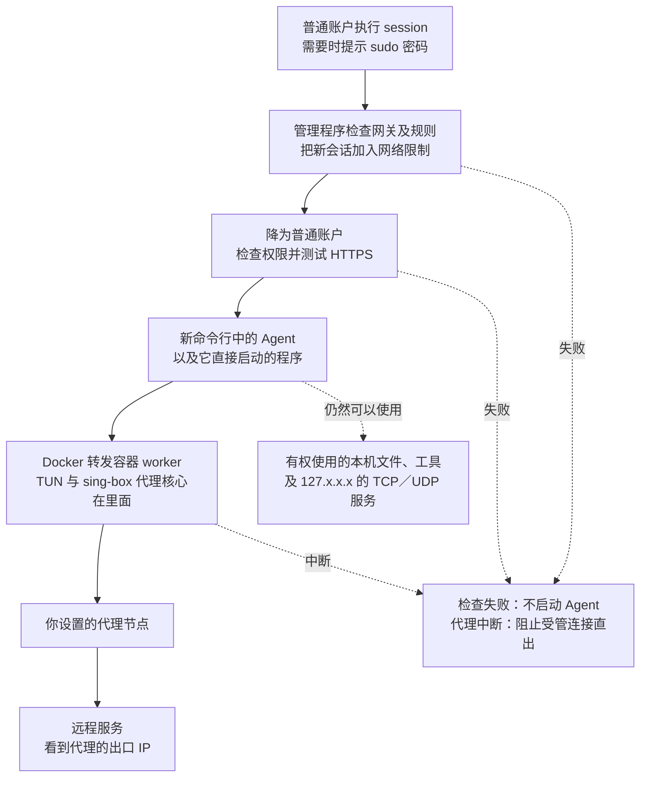

# Agent 网络沙盒（sing-box 加强版）

[繁體中文](README.md) | [简体中文](README.zh-CN.md) | [English](README.en.md)

让 Agent 智能体通过你指定的代理上网，减少它在连接或自动上传使用信息时，暴露你真实公网 IP 的机会。正常经由代理连接时，远程服务看到的是代理的出口 IP。

这是原 SOCKS 简易版的加强版本，**在 Docker 容器内置 sing-box 代理核心**，不再需要你另外开一个本地 SOCKS 入口；同时加入更严格的权限限制、启动前检查，以及代理或网络故障时阻止直连的措施。

随附的 `network.json` 使用 Hysteria2 作为配置示例。本版会依固定 sing-box 1.14.2 核心的受支持配置，自动推导代理的外层 TCP／UDP、端口跳变、候选出站及 detour，配套主机和容器的路由、防火墙与 DNS。更换受支持协议不需要手改两套规则；完整边界见 [协议与功能矩阵](docs/protocol-matrix.md)。

本版也会自动选择可用的 cgroup v1／v2，**优先 v1**。Ubuntu 20.04.6 hybrid／v1、Ubuntu 26.04.1 纯 v2，以及 Debian 13.7 KVM 纯 v2 已有 Hysteria2 与 HTTP CONNECT 的受控实机结果；各系统实际涵盖的故障与限制见 [验证记录](docs/VERIFICATION.md)。

Agent 仍然在你的电脑上运行，可以使用原本有权访问的文件、开发工具和本机服务，也可以启动 GUI 应用。这个项目的重点，是减少一般遥测容易看到的代理设置与 TUN 网卡线索，降低网络环境被误判为异常的机会。维护者已使用本方案运行 Claude Code 数月，日常运行稳定。

## 为什么用这种方式，而不是全局 TUN 或 HTTP／HTTPS 代理

**两个重点是：代理不可用时严格阻止直连（fail-closed），以及减少明显的代理线索。** 实际转发由系统和 Docker 容器处理，只替指定的这组程序更换出口，不需要逐一替 Agent 或它使用的工具设置代理。

**代理或网络故障时，宁可断网，也不绕过代理改用真实出口，这就是 fail-closed。** 对沙盒里的 Agent 或其他程序来说，代理不可用时应该是连接失败、超时或中断，而不是悄悄用电脑原本的公网 IP 继续上网。

这是与只接管路由、没有正确设置断线保护的全局 TUN 方案相比，一个关键差别。有些 TUN 工具在断线、退出或重新连接时会恢复原路由，这段期间的流量可能直接送出；“会自动重连”本身并不能保证重连期间不直连。具备正确断线保护的 TUN 工具也能做到 fail-closed，仍需核对具体设置。

本版的防直连规则不依赖代理核心一直存活，退出收尾也会保留共同限制。在受管范围内，代理进程停止、代理通道断线或网络故障的结果是外网连接中断，不会为了恢复连接而自动放行真实出口。

三种方式的差别，主要在于 Agent 平常能直接看到什么：

- **HTTP／HTTPS 代理**：代理地址常出现在程序设置、启动参数或环境变量中，容易被直接读到；没有采用这些设置的工具，也可能直接连接。
- **全局 TUN**：通常会在电脑上出现可查看的 TUN 网卡和相关路由，留下比较明显的虚拟网卡线索；其他程序也可能一起改变出口。
- **本项目**：不替 Agent 设置代理环境变量，TUN 网卡放在 Docker 容器内。管理程序和代理设置放在只有 root 可以访问的目录，Agent 以普通账户运行，没有相应权限就无法通过 Docker 管理接口查看容器设置，也不能直接读取 iptables 规则。

对正常发起连接的程序而言，仍然是指定目标网站，由系统在背后代为转发。程序的使用方式像直连，实际对外公网出口仍然是代理。容器和转发程序也使用一般的组件名称，减少常见代理名称直接出现在日常检查中的机会。这些安排有助于减少一般遥测仅凭明显线索，就把网络环境判定为异常的情况。

**Agent 仍然可以查看本地 IP、网卡和路由，但经外部网站查询的公网出口 IP 应是代理出口。** 本机列表中没有容器内的那张 TUN 网卡；仅查看本地网络信息，不能准确判定是否经过代理或处于网络隔离环境。这也不代表刻意调查本机的程序永远无法发现其他线索。

| 比较项目 | 本项目 | 全局 TUN | HTTP／HTTPS 代理设置 |
| --- | --- | --- | --- |
| 容易看到的代理线索 | 不必填代理变量，TUN 在容器内，代理设置只供管理员读取。 | 通常能看到 TUN 网卡和相关路由。 | 代理地址可能出现在程序设置、启动参数或环境变量中。 |
| 哪些程序会走代理 | 从 `session` 启动的 Agent 与它直接启动的程序。 | 通常接管整台电脑；只处理部分程序需另外分流。 | 取决于哪些程序采用了代理设置。 |
| 每个工具都要支持代理吗 | 一般不需要，由系统转发。 | 一般不需要，由系统转发。 | 需要逐一确认，子程序也未必采用同一设置。 |
| UDP 通信 | 由 sing-box 经代理转发；所选协议、节点及配套设置须支持 UDP。 | 取决于使用的工具与代理服务。 | 一般 HTTP／HTTPS 代理设置无法处理 UDP。 |
| 代理或网络故障时 | 维持 fail-closed，受管程序断网，不回退直连；退出收尾仍保留限制。 | 未设好断线保护时，可能在退出或重连期间回到原路由并直接送出；有正确保护的工具可避免。 | 单靠代理设置不提供系统层的断线保护，是否重试直连取决于程序。 |
| 对其他程序的影响 | 其他终端原本运行的程序，不会自动一起换出口。 | 浏览器、下载及其他程序可能一起改变出口。 | 可只设置个别程序，但要逐一确认有没有漏掉。 |

本项目内部也使用 TUN，差别在于把它放进容器，再只接管指定的这组程序。若你希望整台电脑都走代理，全局 TUN 会更直接；若只使用一个明确支持 HTTP 代理的工具，直接设置该工具也更省事。

## 使用前需要准备什么

- **符合条件的 Linux／systemd 电脑。** 自动优先选择可写入且通过内核匹配探测的 cgroup v1 `net_cls`；否则尝试 systemd cgroup v2 与 legacy `xt_cgroup --path`。IPv4、IPv6 两套匹配都要可用，两种模式皆不符合就拒绝启动。已测环境包括 Ubuntu 20.04.6／systemd 245 的 hybrid 主机，以及 Ubuntu 26.04.1／systemd 259、Debian 13.7／systemd 257 的纯 v2 主机；其他版本仍须通过本机能力探测与相应验收。
- **一般的 Docker 安装与 Docker Compose。** 需要由系统管理员管理的 Docker，不能直接换成 rootless Docker 或把网关放进另一层普通容器。
- **legacy 版防火墙工具。** 系统需有 `iptables-legacy`、`ip6tables-legacy` 及对应的 restore 命令；不要求你把整台电脑的默认工具切换成 legacy。
- **可供固定核心使用的代理节点。** 节点当前必须是固定 IPv4，最终代理至少保证 TCP。可用协议、明确端口区间及代理链见下方说明；域名／IPv6 节点与动态发现尚未适配。
- **可以使用 sudo 的管理账户。** 用来安装、准备网络和启动会话；实际执行 Agent 的账户可以是另一个没有 sudo 权限的普通账户。

系统还需要 Bash、curl、jq、iproute2、util-linux、procps，以及 Docker CLI 和 systemd 的命令。Python 3 供测试工具使用，日常启动 Agent 不依赖 Python。

可以先在终端做几项不会修改网络的检查：

```bash
docker compose version
systemctl --version
iptables-legacy --version
ip6tables-legacy --version
findmnt -t cgroup,cgroup2
cat /proc/1/cgroup
test -c /dev/net/tun && echo "TUN 可用"
```

若使用旧版 Compose，第一行改为 `docker-compose version`。这些命令只能帮你发现部分缺少的条件，不能代替完整的启动检查。请勿为了让检查通过，就直接切换整台电脑的 cgroup 或防火墙设置。

## 安全加强：修改时区和语言

使用前，建议自行调整电脑的时区，以及执行 Agent 的账户所使用的语言。即使已经换了代理 IP，Agent 仍可能读取原本的时区和语言并上传，供远程服务推测你的所在地。

你可以按照代理出口所在地与自己的使用需求选择，例如：

- **时区**：UTC，或美国纽约、洛杉矶等地的时区。美国有多个时区，需要选择具体城市。
- **语言**：英文（美国或英国），也可以选择德文、法文等其他语言，并一起调整日期和数字格式。

**本版会沿用启动它的终端所使用的时区与语言，不会自动替你换成其他地区。** 下面以 Ubuntu 桌面版的 UTC 和英文（美国）示范，你可以换成自己选择的时区与语言。

### 1. 选择并修改时区

先到 Ubuntu 的“设置 → 日期与时间”，关闭“自动时区”，避免系统根据位置把时区改回去。自动校正时间可以保留，不需要把电脑的时间调快或调慢。

例如，使用 UTC：

```bash
sudo timedatectl set-timezone UTC
timedatectl
```

使用美国纽约时，将 `UTC` 换成 `America/New_York`；洛杉矶则使用 `America/Los_Angeles`。也可以用 `timedatectl list-timezones` 查看其他可选时区。

**这会改变整台电脑的时区，退出沙盒后仍然保留。**

### 2. 选择并修改账户语言

1. 开启“设置 → 地区与语言”。部分 Ubuntu 版本需要先进入“系统”分类。
2. 选择所需语言，例如 **English (United States)** 或 **English (United Kingdom)**。若没有该语言，先到“管理已安装的语言”安装对应的语言包。
3. 将“格式”改为对应地区，让日期和数字格式一起调整。
4. 保存后，**注销 Ubuntu 再重新登录**。只关闭终端或锁定屏幕，不足以让所有程序应用新设置。

语言设置主要影响当前账户，退出沙盒后仍然保留。若 Agent 使用另一个专用账户，也要确认那个账户自己的设置。

### 3. 确认设置，再启动 Agent

重新登录后，开启新终端，执行：

```bash
date '+%Z %z'
locale
```

确认结果与你的选择一致。例如，UTC 和英文（美国）通常应显示 `UTC +0000`，语言设置以 `en_US` 为主。

若结果仍被旧设置覆盖，检查启动账户及 Agent 账户的 `~/.bashrc`、`~/.profile` 是否另外指定了语言或时区。进入 `session` 后也应再确认一次，因为交互式 shell 会读取自己的设置。

这些调整只能减少原本时区与语言被直接上报，不会改变字体、主机名、账号信息或其他本机信息。

## 怎么使用

以下以安装在 `/opt/session` 为例。安装目录会只允许 root 访问，**不要把它当成 Agent 的工作目录**；你的项目应放在普通账户有权读写的位置。

如果旧版沙盒仍在运行，先用旧版入口结束全部会话，再按 [离线升级与重新绑定程序](docs/offline-upgrade.md) 处理。旧版四行 binding 或简单 ready marker 不能直接沿用；不要让两套规则同时接管，也不要清空整台电脑的防火墙来处理冲突。

### 1. 将项目放到最终安装目录

在普通账户的终端中执行以下命令。以下命令会下载本项目的公开仓库：

```bash
sudo install -d -o root -g root -m 0700 /opt/session
sudo git clone https://github.com/alexliyu7352/agent-network-sandbox-enhanced.git /opt/session
```

`/opt/session` 必须尚未存在或为空目录。程序之后直接使用这份项目文件，不会另行复制一份进行安装。

安装目录及其父目录必须由 root 拥有，不能让其他账户写入。路径只能包含英文字母、数字、`/`、`_`、`-`。不要为了通过检查，就递归修改整个 `/opt` 或其他项目的所有者与权限。

### 2. 设置内置的 sing-box 代理

```bash
sudoedit /opt/session/network.json
```

下面先按随附的 Hysteria2 示例说明。在 `outbounds` 中找到 `type` 为 `hysteria2` 的那一项，修改以下字段：

| 字段 | 示例值 | 你应该填什么 |
| --- | --- | --- |
| `server` | `192.0.2.1` | 代理服务器的实际 IPv4 地址，不能填域名。 |
| `server_port` | `443` | 代理服务器的实际端口号。 |
| `password` | `CHANGE_ME` | 代理服务提供的密码。 |

**公开版中的地址和密码都是示例，不能直接使用。请勿把填好真实信息的配置文件提交到公开仓库。**

**本版已实现以下配置的静态策略适配：** Hysteria 1／2、TUIC、Shadowsocks、Trojan、VMess、VLESS、Snell 4／6、HTTP／HTTPS CONNECT、SOCKS4／4a／5 的 TCP、SOCKS5 UoT、SSH、Naive，以及作 detour 包装的 ShadowTLS 1／2／3。另支持 selector、urltest、兼容的 detour、明确的 Hysteria 端口区间，以及矩阵列出的 V2Ray transport、UoT 和 multiplex 组合。Naive 需要镜像包含对应构建标签；已核对的 amd64 测试镜像具备此标签。

**HTTPUpgrade 与 AnyTLS 本版明确拒绝。** 固定核心配对的 HTTPUpgrade 重复验收在 Trojan／VMess／VLESS 上出现间歇失败；可按服务端改用原生 TCP、HTTP、WebSocket、gRPC 或 QUIC。AnyTLS 虽通过一次有限的复用连接恢复对照，仍未通过后续节点故障解除后的 HTTPS 恢复，请改用另一个已验收的代理协议。这些是固定核心下的具体验收边界；完整成功与失败证据见[追加验证记录](docs/validation-20261019-followup.md)。

未加密的 SOCKS5 UoT 或 VLESS 可能让代理流内的 DNS／UDP 内容在链路上可见。端点限制和 DNS 拦截控制流量路径，内容保密仍取决于原始代理和 TLS 设置。程序不会自动修改这些设置。

[公开配置示例](examples/proxies/) 和 [固定核心协议矩阵](docs/protocol-matrix.md) 说明每种配置的外层连接、内层能力及拒绝原因。服务端的协议、认证和证书仍由你正确填写；程序不探测节点、不猜密码。官方文档会更新，字段必须符合本项目固定的 1.14.2 核心。

[共用解析器](gateway-policy.jq) 供主机与容器一起使用。它沿全部候选和 detour 推导真正的外层端点，只放行必要的 IP／协议／端口或区间。例如 Hysteria2 的 `network:"tcp"` 只限制内层，外层仍是 UDP；TCP CONNECT 代理则使用外层 TCP。SOCKS 原生 UDP 的 relay 是动态协商，尚未适配，必须明确使用 TCP 或兼容的 UoT。未知选项、direct 出站、额外服务、remote rule set、未管理的 DNS／路由等会明确拒绝。

当前示例沿用 `tls.insecure: true`，这表示跳过代理服务器的证书验证；连接有加密，也不能因此保证节点身份已经核实。若节点提供可验证的证书，请按服务端要求调整 TLS 设置，不要把跳过验证当作必要条件。

程序不修改你的原始 `network.json`，也不自动改动 TLS、认证或 log。日志级别以原始配置中的 `log.level` 为准，Compose 不再通过 `LOG_LEVEL` 覆盖；修改这些内容也属于配置变更，需要离线重新绑定。

请保留示例的受管 TUN、DNS 与 route 结构。DNS 始终经 `proxy`，保持 IPv4 策略及开启缓存：所有候选都保证 UDP 时使用 `1.1.1.1:53`；只保证 TCP 时，自动生成经代理的 HTTPS DNS，向 `1.1.1.1:443` 的 `/dns-query` 查询并验证 `cloudflare-dns.com` 的 TLS 名称。DNS 地址不会加入外层直连放行列表。

**最终代理必须保证 TCP，UDP 则依配置与服务端能力而定。** 只有 TCP 的出站可以正常使用 HTTPS DNS，但普通 UDP 应用会失败；混合候选组只在所有候选都能承载 UDP 时才把它列为保证能力。启动时会提示 UDP 不受保证，不能把提示视为 UDP 已验收。Hysteria2 等 QUIC 协议的外层仍需网络允许节点 UDP；网页能打开不能代替 UDP、DNS 和故障阻断的确认。

### 3. 安装 `session` 命令

```bash
sudo /opt/session/install-dev-session.sh --check
sudo /opt/session/install-dev-session.sh
```

第一行只检查。第二行会收紧项目目录的权限，并创建 `/usr/local/bin/session` 启动器；它不会启动容器，也不会修改路由或防火墙。

安装后，整个 `/opt/session` 只有 root 能进入，代理配置文件只有 root 能读写。这是为了避免 Agent 直接读到节点信息，请勿再把安装目录开放给普通账户。

若检查发现文件属于普通账户、可被其他人写入，或包含符号链接／硬链接，会拒绝安装。建议直接用上一步的方式取得一份由 root 拥有的干净项目，不要把任意来源的文件直接改成 root 拥有后就当成可信程序。

### 4. 创建并启动转发容器

```bash
sudo docker compose -p worker -f /opt/session/docker-compose.yml build
sudo docker compose -p worker -f /opt/session/docker-compose.yml up -d
sudo docker compose -p worker -f /opt/session/docker-compose.yml logs --tail=50 worker
```

使用 Compose v1 时，把 `docker compose` 换成 `docker-compose`。

容器名称是 `worker`。代理设置只在运行时以只读方式挂载，不会复制到 Docker 镜像。日志中没有明显错误，也不代表已经可以上网，下一步仍会检查。

### 5. 初始化网络限制

```bash
session init
```

这一步才会创建本工具使用的网络规则和转发路径。它不更换电脑原本的默认网关，也不全机关闭 IPv6。

`init` 只能在所有本工具的会话都已结束时执行。若容器还没准备好，命令会失败并保留已创建的限制；请查看容器日志，待问题处理好后再试。

首次初始化会选定 cgroup 模式并保存版本 2 的 binding，绑定该模式、cgroup 身份、容器／Docker 网络／网络 namespace、规范化策略，以及原始配置、有效配置和解析器三份 SHA-256。后续入场会重新核对；即使只改密码、TLS 或 log，或只是重启容器但 namespace 已变，也不会沿用旧绑定。`init` 不会自动接受这类变更，请先关闭全部会话并按 [离线程序](docs/offline-upgrade.md) 重新绑定。

**`init` 或 `check` 显示成功，只代表本机规则检查通过，没有替你测试代理是否真的能连上外网。**

### 6. 用普通账户开启会话，再启动 Agent

回到普通账户可读写的项目目录，直接执行：

```bash
session
```

**日常请直接用普通账户执行 `session`，不用在前面加 sudo。** 需要管理员权限设置网络时，启动器会自行调用 sudo，必要时提示你输入密码。管理程序会先降回普通账户，确认权限和连接正常，才开启新的命令行环境。

本版明确拒绝以 root 身份运行 Agent。管理程序使用 sudo，不代表 Agent 也会取得 root 权限；你也不应在外面的 root 终端直接启动 Agent。

成功后，新的命令行环境仍位于你原本的项目目录。**就在这里执行平时使用的 Agent 启动命令。** 从这里启动的 Agent，以及它直接启动的程序，才会受到这组网络限制；已在其他终端运行的程序不会自动加入。

也可以直接执行单条命令，命令及参数必须放在 `--` 后面：

```bash
session -- /usr/bin/curl -q --noproxy '*' -4 https://example.com
```

**如果启动失败，你仍然停留在外面的普通终端，请不要以为已进入沙盒，直接在那里启动 Agent。**

### 7. 确认连出去的是代理 IP

在新开启的会话中执行：

```bash
curl -q --noproxy '*' -4 --fail --show-error --connect-timeout 5 --max-time 15 https://www.cloudflare.com/cdn-cgi/trace
```

输出中 `ip=` 后面是这次连接的公网 IP，请确认它与你的代理出口一致。**启动检查只确认 HTTPS 能连接，不会自动比较这个 IP 是否符合你的预期。**

命令中的 `-q` 和 `--noproxy '*'` 是为了忽略 curl 自己的配置文件与代理设置，确认系统转发这条路径。

### 8. 用完后退出

先保存工作并正常退出 Agent 或应用程序，再在会话中输入：

```bash
exit
```

系统会停止这个会话内的程序；先要求正常结束，超过约 10 秒仍未退出的程序会被强制结束。**从里面启动的后台任务，也会一起被关闭。**

网络防直连规则会保留，不会为了收尾先解除限制。你可以在外面的终端查看仍在运行的会话：

```bash
session status
```

需要手动关闭时，用启动时显示的 32 位会话 ID 取代下面的示例：

```bash
session close 0123456789abcdef0123456789abcdef
```

如果所有 Agent 都已经用完，也可以停止转发容器：

```bash
sudo docker compose -p worker -f /opt/session/docker-compose.yml stop
```

停止容器会让仍在使用它的会话失去外网连接，不会替它们改回真实出口。

### 可选：让 Agent 使用专用账户

如果不希望 Agent 直接使用你的日常账户，可以由管理员创建普通账户，例如 `runner`：

```bash
sudo adduser --disabled-password --gecos '' runner
sudo -u runner mkdir -p /home/runner/project
session -u runner --cwd /home/runner/project
```

`runner` 不需要 sudo 权限，也不要加入 `sudo`、`docker`、`lxd` 等管理组。它有自己的 HOME、Agent 登录信息和设置；你需要为它准备工作文件和开发环境。

执行会话时会清除附加组，因此只把账户加入某个项目组，未必能让它读写那个项目。请使用该账户自己的工作目录，或由管理员只对需要的项目授予访问权限，不要把整个日常账户的 HOME 开放出去。

没有指定 `--cwd` 时，默认使用你执行 `session` 的当前目录。若目标账户无权进入，会直接报错，不会暗中改去其他目录继续执行。

### GUI、语言与文件权限会怎样

从自己的桌面终端执行 `session` 时，会保留原终端的语言、时区，以及新建文件的默认权限。需要另外指定文件权限时，可用 `session --umask 0022` 等选项。

使用相同账户时，也会传递 X11／Wayland 所需的部分桌面设置，方便启动 GUI 程序；换成 `runner` 等其他账户时，不会把你的桌面访问信息一并交给它。

这不代表所有 GUI 程序都已验证可用。有些程序会把工作交给会话外原本运行的实例；那个实例不会因为开了一个新窗口，就自动受到本工具限制。需要确认实际执行工作的程序在哪个会话中。

一般代理环境变量不会从外层终端直接带入。不过，Agent 自己的设置或 `~/.bashrc` 仍可能再次设置代理、语言和时区，请另行确认。

## 它是怎么工作的

### 原理图



系统会记住“哪些程序是从这个会话启动的”，再把这些程序的外部 IPv4 连接送进指定的 Docker 容器。容器内的 sing-box 使用 TUN 接收连接，再经配置的代理出口送出；随附示例使用 Hysteria2。一般使用时，Agent 不需要知道代理地址。

cgroup v1 使用 `net_cls` classid；v2 使用常驻的 systemd `devsession.slice` 父组，各会话 service 在其下面创建，legacy 防火墙以父路径匹配子孙。选定后不会在运行中自动换模式；挂载、父组身份或开机身份不符时保留限制并拒绝新会话。v2 父 slice 不随最后一个会话退出而删除，以保留现有 socket 与规则所依赖的身份。

几个加强措施分别负责：

- **不让 Agent 接手管理权限。** 设置网络需要的 root 权限留在管理程序；Agent 启动前会降为普通账户、清除附加组和可用的管理能力，并禁止通过一般提权方式重新取得管理权限。
- **检查通过才执行 Agent。** 先核对网关、防火墙和路由，再以实际 Agent 账户进入工作目录、检查权限及测试 HTTPS；任一步失败，都不执行你的命令。
- **代理出问题就停止连接。** 系统保留不可用的备用路径，并检查最后的送出位置；容器本身也只允许经 TUN 或连往指定节点的外层通信，避免代理失效时改走普通出口。
- **统一常见的网站地址查询。** DNS 是把网站名称查成 IP 的服务。会话发出的 IPv4 TCP／UDP 端口 53 查询会被交给容器，再经同一代理向 `1.1.1.1` 查询，并使用缓存。
- **分开管理每个会话。** 每次开启一个独立的 systemd service，负责关闭这个会话的全部程序；共同网络规则不会随着会话数量一直增加。
- **收尾时仍保留限制。** 退出只关闭对应会话并回收它的临时数据，不移除共用的防直连规则，也不清理其他会话的网络。

## 哪些事情它做不到

### 它限制的是网络，不是所有本机操作

Agent 仍然使用电脑原本的文件系统和工具，可以查看本地 IP、网卡、路由、进程和其他有权读取的本机信息。本工具没有另外限制它能读哪些文件、能用多少内存，或能启动哪些普通程序。

这里需要分清楚两种地址：网卡上的本地 IP，例如 `192.168.x.x`、`10.x.x.x`，描述的是电脑和本地网络；经外部网站查到的公网出口 IP，则应该是代理的出口 IP。能查看本地网卡和路由，不代表经受管连接查到的会是电脑原本的公网出口。

本工具不会改写网卡信息或清除文件里既有的地址；若主机网卡本身直接配置了公网 IP，该地址也仍属于可读取的本机信息。

本机服务和进程之间的通信也仍然存在。如果 Agent 把工作交给会话外已在运行的服务，或请本机服务替它连接，那个服务不会自动加入这组网络限制。因此，这不是用来执行不可信恶意程序的完整沙箱。

### Agent 上传了什么，仍要另外管理

本工具改变连接出口，不会删掉 Agent 上传的内容。若它上传账号、设备编号、主机名、时区、文件内容或本地 IP，远程服务仍可能据此识别设备或使用环境。这与连接的来源公网 IP 是两回事：经代理送出的连接，来源仍是代理出口。请另外检查 Agent 自己的隐私和遥测设置。

代理服务提供者也可能看到或记录连接。本工具不提供对代理服务商匿名的保证，也不能保证任何 Agent 都会认为自己在直连。

### 连接范围有限制

| 连接种类 | 本版行为 |
| --- | --- |
| 公网 IPv4 的 TCP／UDP | 经 Docker 网关及代理图转发；普通 UDP 需要兼容出站与服务端，只有 TCP 的出站不会改用直连补足 UDP。 |
| 电脑本机 `127.0.0.0/8` 的 TCP／UDP | 可以使用任意端口，但目的端口 53 另行拦截。 |
| 任意 IPv4 地址的 TCP／UDP 端口 53 | 交给容器，经代理向 `1.1.1.1` 查询。 |
| 内网、局域网、link-local、组播等地址 | 拒绝，不能直接连到路由器或其他局域网设备。 |
| IPv6，包括本机 `::1` | 拒绝；只提供 IPv6 的服务不能直接使用。 |
| ICMP，例如一般 ping | 不作为代理通信支持项目，不能用 ping 是否成功判断代理好坏。 |

固定 DNS 可能让公司内部域名或依赖专用 DNS 的服务无法使用。经 HTTPS／TLS 查询地址的工具仍按一般连接处理，不会被改成普通端口 53 查询；请求本机其他服务代查，则属于前面说明的本机服务范围。

### 启动成功不代表之后一直正常

HTTPS 检查只在启动时做一次，不是持续健康监控，也不会自动核对出口 IP。进入之后代理仍可能断线，这时应该连不上，而不是自动换另一条路径。

可以同时开多个会话，但它们共用同一套出口设置，不会各自取得不同的公网 IP。

## 当前需要注意的限制

| 情况 | 建议怎么处理 |
| --- | --- |
| 系统只有 cgroup v2 | 自动尝试 systemd v2 与 IPv4／IPv6 legacy path 匹配；条件不足就拒绝。Ubuntu 26.04.1 与 Debian 13.7 KVM 已通过下列纯 v2 测试范围；不要因此跳过本机探测或盲目改开机设置。 |
| 更换协议、transport、端口跳变或 detour | 按 [协议矩阵](docs/protocol-matrix.md) 填写配置，规则自动推导；固定 IPv4 以外的发现方式及未列入的能力明确拒绝。 |
| 已初始化后修改任何原始配置或解析器 | 原始、有效配置及解析器的哈希均须一致；先关闭全部会话，再 [离线重新绑定](docs/offline-upgrade.md)。仅密码、TLS、log 或 JSON 格式改变也包括在内。 |
| 容器 restart／recreate／rebuild 或 Docker 网络重建 | container ID、network ID 或网络 namespace 身份改变就不能沿用 binding；同名容器也一样，需要离线重新绑定。 |
| Docker daemon 重新启动 | 身份不变但规则顺序改变时，全部会话关闭后可执行 `session init` 修复；若 namespace 或其他绑定身份已变，则走离线程序。没有无缝恢复承诺。 |
| 入口被 `SIGKILL` 等方式强制杀掉 | 会话可能仍在运行，但限制会保留。请用 `session status` 和 `session close ID` 处理。 |
| 使用远程工具直接传入 socket 作为标准输入输出 | 会拒绝启动；需要使用一般终端、PTY 或 pipe。 |
| 从 root 终端直接启动 | 没有有效的原普通账户信息时，必须明确指定 `-u 普通账户`；不允许 root 工作负载。 |
| 要卸载本工具 | 先退出所有 Agent 与会话，再停止网关；请管理员核对并只移除本工具的共用规则和状态，最后再移除安装目录与 `session` 启动器。当前没有自动卸载命令，不要只删目录或清空全机规则。 |

请不要删除 `/run/dev-session-v8` 的状态来强行接受新网关，也不要清空整台电脑的防火墙来处理错误。退出后保留共同限制是本版的设计，不能把“还有规则”直接当成清理失败。

## 怎么测试

### 用浏览器做直观检查（GUI 应用）

本项目也可以让 GUI 应用使用沙盒网络，不限于命令行程序。可以用浏览器做直观检查：

1. 从图形桌面的普通账户终端进入沙盒，再**在沙盒命令行内启动浏览器**。
2. 先完全关闭原本运行的浏览器，或按浏览器支持的方式使用独立配置文件及新实例。只从桌面点开浏览器，或让启动命令把网页交给外面的旧进程，都不能保证该浏览器已受管。
3. 开启 [BrowserLeaks](https://browserleaks.com/) 或 [BrowserScan](https://www.browserscan.net/)，查看公网 IP、WebRTC、DNS、时区和语言等结果。
4. **公网 IP 应是代理出口；WebRTC 若显示公网地址，也应是代理出口，或没有可用的公网结果。** 出现本地私有 IP 本身不等于真实公网出口泄漏，但若出现原本的公网出口，就应停止使用并检查。

DNS 测试可能显示解析器的地址，它通常不同于代理出口，不能仅凭两者不同就判定泄漏。浏览器自行启用的加密 DNS 也会影响结果。时区、语言、字体和其他浏览器信息不会因更换出口自动改变；网站显示“代理／VPN”标签也不等于真实出口泄漏，请核对各项实际地址结果。

要观察断线保护，只在可以中断连接的测试环境中操作：保持沙盒与浏览器运行，从外部暂停代理，并发起新的网络请求。预期结果是请求失败，不能改用原公网出口；已缓存或已加载的页面不能用来判断是否仍可上网。正常浏览检测网站只反映当次测试，不能代替故障测试或数据包检查。

使用专用账户时，浏览器需要该账户本身可用的桌面环境；`session -u runner` 不会自动取得日常账户的桌面授权。

### 只检查文件格式

以下命令只检查 Shell 语法，不会执行脚本内容、启动容器或修改网络。在项目目录执行：

```bash
bash -n dev-session
bash -n session-launcher
bash -n install-dev-session.sh
bash -n lib/main.sh
bash -n lib/host.sh
bash -n lib/network.sh
bash -n lib/cgroup.sh
bash -n lib/session.sh
bash -n lib/cli.sh
bash -n lib/context.sh
sh -n entrypoint-gateway.sh
```

要核对发布文件的 SHA-256，可在**尚未填入真实代理信息或修改其他文件前**执行：

```bash
sha256sum -c MANIFEST.sha256
```

哈希相符只代表文件与这份清单一致，不代表网络隔离已通过实机验证。

### 离线回归与实机测试

`tests/test_*.py` 是回归测试，会执行脚本和创建临时测试环境；部分测试需要 root、普通账户或指定的 sing-box 可执行文件，条件不足可能跳过。请先阅读测试内容，再在合适的测试环境执行。

**`tests/host_*.py` 会真的启动会话、修改测试网络，部分还会停止网关或重新启动 Docker。只能在可以中断网络、可以恢复的测试机上使用。** 不要在日常工作的电脑上直接执行整套故障测试。

需要重验时，请使用 [实机验收清单](docs/host-validation.md)。网页能开、某个测试没有 FAIL，或某个项目因权限不足而跳过，都不能代替对 UDP、DNS、故障断线及退出清理的确认。

### 已有验证记录

截至 **2026-10-19**，证据按实际执行层次分开记录：

| 层次与环境 | 已通过的范围 |
| --- | --- |
| 配置检查 | 初轮 24／24 份示例通过共用解析器及真实 sing-box 1.14.2 核心检查；后续撤下 AnyTLS，现行保留 23 份公开示例。假节点不因此变成可用节点。 |
| 真实协议 loopback | 初轮 47 组各至少一次通过；后续验收使三个 HTTPUpgrade 案例及 AnyTLS 被明确拒绝，现行默认为 43 组。TCP、UDP 或按能力拒绝、DNS 缓存／TTL 和停止 server 后的阻断记录保留。这一层不代替主机 cgroup／TUN／防火墙验收。 |
| Ubuntu 20.04.6 hybrid／v1 | Hysteria2 与 HTTP CONNECT 的核心／故障套件各 17／17，两者的代理出口 IP 比对通过。另完成 v1 生命周期 10／10（含 100 个短会话）、能力 13／13、CLI 9／9。 |
| Ubuntu 26.04.1 原生纯 v2 | Hysteria2／HTTP 各执行 healthy、gateway-stop、gateway-kill、gateway-recreate、docker-restart，共 10／10 CI jobs 通过；包括真实会话、抓包、出口 IP 与生命周期验收。 |
| Debian 13.7 KVM 纯 v2 | Hysteria2／HTTP 的 healthy jobs 共 2／2 通过；各含核心 16／16、生命周期 10／10、100 个短会话及出口 IP 比对。Debian 的容器／Docker namespace 故障不在这两个 job 范围内。 |

逐协议主机初轮 [CI 39202665481](https://github.com/alexliyu7352/agent-network-sandbox-enhanced/actions/runs/39202665481) 为 **50／59**，第二轮 [CI 39206996173](https://github.com/alexliyu7352/agent-network-sandbox-enhanced/actions/runs/39206996173) 为 **54／56**，第三轮 [CI 39261938798](https://github.com/alexliyu7352/agent-network-sandbox-enhanced/actions/runs/39261938798) 为 **54／55**，三轮均保留为失败。第三轮唯一失败为健康阶段的 UDP DNS 查询超时，后续有界查询与完整尝试证据仍须重新验收。HTTPUpgrade／AnyTLS 的明确拒绝、抓包完整性修正及 43＋12 组关卡见[追加验证记录](docs/validation-20261019-followup.md)。

纯 v2 结果来自 [CI 39182626891](https://github.com/alexliyu7352/agent-network-sandbox-enhanced/actions/runs/39182626891)（`58dcfad596856fc3696d138f84d1c0f37e6e0ebd`），**12／12 jobs 通过**。v2 证据另核对会话创建的实际 socket inode 与所属 service cgroup。容器重建确实更换 container ID 与 namespace；旧 binding／共同规则保留，`check`、`init` 及新工作负载入场拒绝，必须离线重新绑定，没有自动沿用新 namespace。

受控 DNS 测试包括跨 TCP／UDP 查询共用缓存、TTL 到期重新查询，以及停用缓存、移除 HTTPS DNS detour 的预期失败负对照。SSH 使用固定核心 client 与独立 Paramiko 3.5.1 server；ShadowTLS 使用内层 Shadowsocks／UoT 与不发送 session ticket 的私有 TLS cover，证书验证保持启用。这些结果限于[协议矩阵](docs/protocol-matrix.md)列出的具体配置。逐协议完整主机出口矩阵与真实 X11／Wayland 窗口验收尚待相应结果；其他未列出的协议选项和主机环境不能沿用上述通过状态。

主机 fixture 使用同机隔离的假认证代理；出口 IP 比对证明受管请求与指定 fixture 的独立观测一致，不能证明远程匿名性或用户实际节点的质量。版本、命令、CI artifacts、跳过原因与历史结果见 [验证记录](docs/VERIFICATION.md)。公开摘要不包含私人节点、凭证、实际出口 IP 或原始抓包。本次改动仍在工作分支，尚未合并 `main`；合并须另行审阅与明确批准。

## 常见问题

**容器已经启动，为什么 `session` 仍然失败？**

先确认已按服务端填写协议、地址、认证与 TLS，所需外层 TCP／UDP 端口可达，并已执行 `session init`。若曾修改配置或重启／重建容器，先检查是否需要离线重新绑定。查看网关日志：

```bash
sudo docker compose -p worker -f /opt/session/docker-compose.yml logs --tail=50 worker
```

`session check` 可以重新检查本机网络限制，但不测试代理连通性。失败时不要直接在外面的终端启动 Agent。

**为什么普通账户不能读安装目录？**

这是刻意限制，避免 Agent 直接读到代理设置。需要修改时使用管理员权限，Agent 的工作文件放到另一个普通账户可用的目录。

**为什么指定 `runner` 后不能进入当前目录？**

`runner` 没有那个目录的访问权限。请替它准备自己的工作副本，或只对所需项目授予访问权限；也可以用 `--cwd` 指定它有权使用的目录。

**本地 IP 和对外公网出口 IP 有什么不同？**

Agent 可以读取本地 IP、网卡和路由等信息；这些信息与对外连接使用的公网出口是两回事。**在限制正常生效、连接经过代理时，Agent 向外部网站查到的出口 IP，以及远程服务实际看到的来源 IP，都应该是代理的出口 IP。**

例如，网卡显示 `192.168.1.10`，而查询公网 IP 显示代理的出口，这是正常结果，不表示真实公网出口已经泄漏。本机信息本身不会被本工具改写，仍需另外管理文件和遥测内容。

**Agent 使用的工具或虚拟环境没有出现？**

会话不会完整复制外层终端的全部环境变量。请进入后再启用所需的虚拟环境，或在该账户的设置中准备好工具。默认命令搜索顺序先使用系统目录，再到该账户的 `~/.local/bin`。

**为什么 ping 不通，但 HTTPS 可以用？**

ping 使用的通信方式不同，本版不按一般 VPN 的方式转发 ICMP。请用实际需要的 TCP／UDP 功能检查，不能只看 ping。

## 项目文档与其他设置

| 文件 | 用途 |
| --- | --- |
| [README.md](README.md) | 安装、使用方式与限制。 |
| [network.json](network.json) | sing-box 代理与 DNS 设置；公开版以 Hysteria2 提供示例数据。 |
| [gateway-policy.jq](gateway-policy.jq) | 主机／容器共用的策略及有效配置解析器。 |
| [examples/proxies/](examples/proxies/) 与 [协议矩阵](docs/protocol-matrix.md) | 固定核心的多协议示例、传输能力与拒绝原因。 |
| [离线升级程序](docs/offline-upgrade.md) | 关闭会话后更新版本、修改配置或重新绑定网关。 |
| [policy.json](policy.json) | 启动检查网址与策略版本。 |
| [docker-compose.yml](docker-compose.yml) | Docker 转发容器设置。 |
| [Dockerfile.gateway](Dockerfile.gateway) | 创建包含 sing-box 和网关工具的镜像。 |
| [entrypoint-gateway.sh](entrypoint-gateway.sh) | 容器启动时创建限制与转发路径。 |
| [install-dev-session.sh](install-dev-session.sh) | 检查安装位置、收紧权限、安装 `session` 命令。 |
| [session-launcher](session-launcher) | 公开启动器模板，在 sudo 前保存选定的终端设置。 |
| [dev-session](dev-session) 与 [lib/](lib/) | 管理会话、权限、网络检查及退出清理。 |
| [tests/](tests/) | 回归与实机验收工具。 |
| [docs/](docs/) | 验证摘要、验收清单及历史技术说明。 |
| [MANIFEST.sha256](MANIFEST.sha256) | 本版发布文件的哈希清单。 |

`policy.json` 的 `probe_url` 可以指定启动时要测试的 HTTPS 网址。程序会使用正常证书验证，不跟随重定向，整个检查最多约 20 秒；目标必须适合直接响应 HTTPS 请求。

日常可使用 `session --help`、`session status`、`session close ID` 及 `session check`。旧式 `sudo /opt/session/dev-session --user runner run --cwd /home/runner/project` 入口仍兼容，但只能取得经 sudo 处理后的终端设置；一般使用时，直接执行 `session` 即可。
